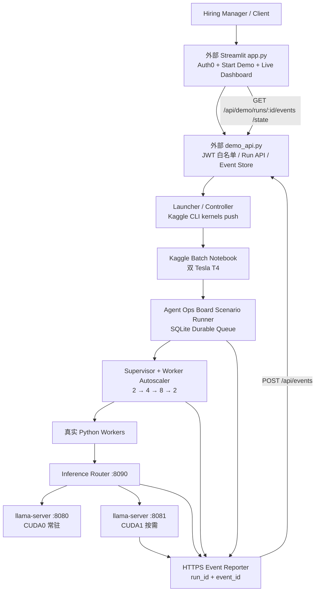

# Agent Ops Board — Kaggle 双 GPU 自适应扩缩容 Live Demo 技术方案

> 版本：v1.0 · 2026-11-17  
> 状态：**实施规格 / 尚未完成自动扩缩容功能**  
> 目标：在现有 **Auth0 私有 Demo + Kaggle Batch + HTTPS Event Reporting** 基础上，实现可验证的 **2 Workers + 1 GPU → 8 Workers + 2 GPU → 2 Workers + 1 GPU**，并在现有前端展示真实扩缩容进程和结果。  
> 范围：**短期 Agent Ops Board Demo**，不重构 DDH/DOAP，不部署 Kubernetes，不修改现有 Debt Collection 六阶段业务流程。

## 0. 先读：已验证事实、假设与边界

### 0.1 当前已验证能力

- Kaggle Notebook `sillypanda5/notebookb061a06458` 由本地 Kaggle CLI 提交 Batch，使用双 Tesla T4，带 Internet。
- 模型：`Qwen3-4B-Instruct-2507 Q8_0 GGUF`；GPU 0 的 llama.cpp server 使用 `127.0.0.1:8080`。
- 已将模型和 CUDA 版 llama-server 放入 Kaggle Dataset：`sillypanda5/agent-ops-qwen-model`、`sillypanda5/agent-ops-llama-cuda-t4`（或沿用可访问的已保存 Cache）。
- 现有模型验证：`python -m workers.check_model --runs 10` 与 `modelcheck.py`；HTTPS 事件已实际收到，前端某次运行可看到 **5 个事件**。
- 事件公共字段：`run_id`, `event_id`, `event_type`, `timestamp`, `source`, `model`, `data`。
- 已存在 Auth0 白名单登录方案，相关服务/代码涉及 `app.py`、`demo_api.py`、`demo_auth.py`、`live_demo.py`（各环境具体文件请以本地 Repo 为准）。
- 旧 Agent Ops Board 运行链使用 Python Supervisor、Worker、SQLite Queue，`desired_workers` 可控制目标 Worker 数量；**尚未证实当前 Kaggle Batch Notebook 已将这套持续运行的 Queue/Supervisor 完整启动并纳入 HTTPS 事件流**，本项目需把它作为明确实施步骤。

### 0.2 关键限制

**Kaggle CLI `kernels push` 执行的是 Batch Notebook：Batch 结束后不能假定本地监听在 8080/8081/8501 的进程持续运行，也不能把 Kaggle 内部 localhost 直接当作公网访问地址。**

所以短期采用：

1. 用户从外部 Auth0 页面登录并点击 **Start Live Demo**。
2. 外部 Controller 启动 Kaggle Batch。
3. Kaggle Batch 运行期间，进行真正的 Worker / GPU 扩缩容和负载实验。
4. Kaggle 以 HTTPS POST 向外部 `demo_api.py` 汇报事件及实时快照。
5. 前端轮询外部 Demo API，显示真实变化；Kaggle Batch 结束后前端仍可回看历史结果。

这是一套 **Live Telemetry Demo**，不等同于“客户浏览器直接访问 Kaggle 中的 Streamlit”。交互式邮件提交 / 远程调用 Kaggle 推理需另行建立安全双向命令通道，**不在本期承诺范围内**。

---

## 1. 目标与验收

### 1.1 两种 Demo 模式

| 项目 | Light Mode | High Concurrency Mode |
|---|---|---|
| Workers 初始/最小 | 2 | 2 |
| Workers 最大 | 2 | 8 |
| GPU 0 模型实例 | 常驻于本次 Batch | 常驻于本次 Batch |
| GPU 1 模型实例 | 不启动 | 负载触发后启动；空闲后停止 |
| 工作负载 | 低频合成邮件 | 例如 50 或 100 个任务，1 秒突发 |
| 扩缩容机制 | 固定配置 | 监测队列 + 推理压力；真实改变进程 |
| 结束状态 | 2 Workers + 1 模型实例 | 2 Workers + 1 模型实例 |
| 前端 | 五个原事件 + 负载指标 | 五个原事件 + Scaling Timeline + GPU 面板 |

**成功不是仅显示 2→8→2 动画；必须从实际 OS Worker 进程与 GPU 1 llama-server PID、模型健康检查、路由计数获得证据。**

### 1.2 验收标准（必须全部满足）

- [ ] 现有五个事件及字段不被破坏；历史 Run 能正常显示。
- [ ] High Concurrency 模式中，实际 Worker 数量 `2 → 4 → 8 → 2`；阈值和时序由真实队列驱动。
- [ ] GPU 1 出现独立 `llama-server` 进程，绑定 **CUDA1**，监听 `127.0.0.1:8081`，`/health` READY 后才加入路由。
- [ ] GPU 0 和 GPU 1 都有 **实际推理请求计数**大于 0（不能只显示 GPU 利用率）。
- [ ] 缩容前所有任务均已完成/进入明确最终状态；GPU 1 请求 Drain 到 0 才关服务。
- [ ] `run_id` 串起模型验证事件、扩缩容事件、GPU 信息、任务统计与前端。
- [ ] 外部 Demo API 可在 Kaggle Batch 运行时逐步收到事件；断网/重复事件不导致状态乱序或错误的 Passed。
- [ ] Kaggle 无 GPU、GPU1 启动失败、推理失败等情况可显示 `DEGRADED`/`FAILED`，**不得伪造双 GPU 成功**。
- [ ] 运行结束输出 summary，包括 scale-out / scale-in 时间、峰值 Workers、GPU 1 是否实际处理推理、总任务、完成任务、P50/P95、吞吐量、重试、失败。

---

## 2. 架构与数据流



### 2.1 各部分职责

| 组件 | 责任 | 部署位置 |
|---|---|---|
| `app.py` / 前端 | 登录、选择模式、Start、五事件、Timeline、GPU/Worker 曲线 | 现有外部 Streamlit |
| `demo_api.py` | 授权、接收 HTTPS 事件、存储、返回状态 | 外部一直在线的 FastAPI |
| Launcher | 串行提交 Kaggle Batch、检测运行状态、限制同一时间任务 | 外部后端/控制器 |
| Notebook | 初始化双 T4 环境、模型与服务、执行测试、上报、清理 | Kaggle |
| `autoscaler.py`（新增） | 计算目标 Worker 与 GPU 1 启停意图 | Kaggle |
| `gpu_manager.py`（新增） | 管理 CUDA1 模型进程、Readiness、Drain、Terminate | Kaggle |
| `inference_router.py`（新增或轻量代理） | 稳定的 OpenAI-compatible 入口 `:8090`，转发到健康 GPU | Kaggle |
| Supervisor | 执行 `desired_workers` 变化，确保缩容不终止忙碌任务 | Kaggle |
| Event Reporter | TLS、重试、幂等 `event_id`、认证签名 | Kaggle → 外部 API |

**本阶段没有理由修改 DDH/DOAP。** 未来可把 Policy/Executor 迁移至 DDH，把 Scaling Events 展示接入 DOAP。

---

## 3. 保持当前五个 HTTPS 事件（不可更名）

你当前 Live Demo 页面实际收到过以下 **5 个**事件：

1. `notebook_started`
2. `model_validation_started`
3. `worker_validation_completed`
4. `modelcheck_completed`
5. `model_validation_completed`

说明：较早的 `Kaggle_CLI_Launch_and_HTTPS_Event_Reporting(1).md` 中 Step 6 定义的是后面 **4 个验证事件**，`notebook_started` 是之后整合进 Live Demo 的启动事件。本方案以当前前端已收到的五事件为准。

### 3.1 原始公共事件 Envelope

```json
{
  "run_id": "run-xxxxxxxx",
  "event_id": "uuid",
  "event_type": "worker_validation_completed",
  "timestamp": "2026-11-17T00:00:00Z",
  "source": "kaggle-gpu-batch",
  "model": "Qwen3-4B-Instruct-2507",
  "data": {
    "test_runs": 10,
    "duration_seconds": 19.06,
    "exit_code": 0,
    "status": "passed",
    "stdout": "...",
    "stderr": ""
  }
}
```

以上时间、数值、文本均为 **Schema 示例**；实际数据必须由本次 Kaggle Run 产生。

### 3.2 原有数据兼容

| Event Type | 现有数据字段（不要移除） |
|---|---|
| `notebook_started` | 保持当前 Notebook 实际发出的原 `data`；不要凭空假设其已有字段 |
| `model_validation_started` | `test_runs`, `status` |
| `worker_validation_completed` | `test_runs`, `duration_seconds`, `exit_code`, `status`, `stdout`, `stderr` |
| `modelcheck_completed` | `duration_seconds`, `exit_code`, `status`, `stdout`, `stderr` |
| `model_validation_completed` | `status`, `backend`, `api_health` |

`model_validation_completed` **只表示原有模型验证完成**，不能替代 `scaling_demo_completed`；双 GPU 测试失败时不得因为模型验证 Passed 就把扩容实验标为 Passed。

---

## 4. 新增 HTTPS 事件：在五项基础上扩展

**保留原有 Envelope**，只增加新 `event_type`。外部 API 与前端以 `event_type` 区分事件，不因增加字段而破坏旧视图。

| 新事件类型 | 产生时机 | 推荐 `data` 关键字段 |
|---|---|---|
| `scaling_demo_started` | 进入扩缩容测试 | `mode`, `min_workers`, `max_workers`, `initial_gpu_instances`, `target_gpu_instances`, `planned_units` |
| `scaling_metrics_snapshot` | 每 2–3 秒（建议） | `pending`, `running`, `completed`, `failed`, `actual_workers`, `desired_workers`, `gpu_instances_ready`, `gpu0`, `gpu1`, `requests_by_gpu` |
| `worker_scaling_requested` | Policy 改变目标数 | `from`, `to`, `reason`, `queue_depth`, `cooldown_until` |
| `worker_scaling_completed` | Supervisor 确认真实进程数到位 | `desired_workers`, `actual_workers`, `worker_pids`（仅内部可见/脱敏） |
| `gpu_instance_starting` | GPU1 进程启动前/刚启动 | `gpu_id: 1`, `port: 8081`, `reason` |
| `gpu_instance_ready` | `/health` 成功且 GPU1 已加载模型 | `gpu_id`, `port`, `model`, `load_duration_seconds`, `memory_used_mb`（若可获得） |
| `inference_route_changed` | Router 开始/停止派发 GPU1 | `active_backends`, `reason` |
| `gpu_instance_draining` | GPU1 停止接收新请求 | `gpu_id`, `inflight_requests` |
| `gpu_instance_stopped` | GPU1 真正退出 | `gpu_id`, `exit_code`, `reason`, `inflight_requests: 0` |
| `scaling_demo_completed` | 本次实验结束 | `status`, `total`, `completed`, `failed`, `p50_seconds`, `p95_seconds`, `throughput_per_min`, `peak_workers`, `peak_gpu_instances`, `gpu1_inference_requests`, `scale_out_seconds`, `scale_in_seconds` |
| `scaling_demo_failed` | 严重错误或整体超时 | `status: failed`, `phase`, `error_code`, `message`（脱敏） |

### 4.1 样例：真实触发 GPU 1

```json
{
  "run_id": "run-xxxxxxxx",
  "event_id": "8d6d7dc9-e7a2-4a43-a42e-1e9f82e03311",
  "event_type": "gpu_instance_ready",
  "timestamp": "2026-11-17T00:01:15Z",
  "source": "kaggle-gpu-batch",
  "model": "Qwen3-4B-Instruct-2507",
  "data": {
    "gpu_id": 1,
    "port": 8081,
    "model": "Qwen3-4B-Instruct-2507",
    "load_duration_seconds": 7.8,
    "memory_used_mb": 4800,
    "status": "ready"
  }
}
```

> 示例数据不是实测结果。缺失的测量字段应发 `null` 或省略，不得填猜测数值。

### 4.2 `scaling_metrics_snapshot` 建议 Schema

```json
{
  "run_id": "run-xxxxxxxx",
  "event_id": "uuid",
  "event_type": "scaling_metrics_snapshot",
  "timestamp": "2026-11-17T00:01:18Z",
  "source": "kaggle-gpu-batch",
  "model": "Qwen3-4B-Instruct-2507",
  "data": {
    "mode": "high_concurrency",
    "pending": 26,
    "running": 8,
    "completed": 16,
    "failed": 0,
    "actual_workers": 8,
    "desired_workers": 8,
    "gpu_instances_ready": 2,
    "gpu0": {"state": "READY", "port": 8080, "memory_used_mb": 4890, "utilization_pct": 87},
    "gpu1": {"state": "READY", "port": 8081, "memory_used_mb": 4820, "utilization_pct": 65},
    "requests_by_gpu": {"gpu0": 18, "gpu1": 6},
    "inflight_by_gpu": {"gpu0": 3, "gpu1": 2},
    "oldest_pending_seconds": 12.4
  }
}
```

前端不应通过 GPU utilization > 0 推断该 GPU 一定运行了 Qwen；**以实例 PID + Readiness + `requests_by_gpu`/完成响应计数作证据**。

---

## 5. Worker Autoscaling 规则（演示版）

### 5.1 基础策略

```yaml
scaling:
  mode: high_concurrency
  poll_seconds: 2
  min_workers: 2
  max_workers: 8
  scale_out:
    pending_gte_4_workers: 10
    pending_gte_8_workers: 25
  scale_in:
    queue_empty_for_seconds: 15
    require_running_zero: true
    target_workers: 2
  worker_scale_cooldown_seconds: 4
```

注意：阈值用于 **Demo**，不是生产最优参数。扩容基于**实际 Queue 读数**，不能按前端时间轴写死。

### 5.2 决策伪代码

```python
def desired_worker_count(mode, pending, running, idle_for_s):
    if mode == "light":
        return 2
    if pending >= 25:
        return 8
    if pending >= 10:
        return 4
    if pending == 0 and running == 0 and idle_for_s >= 15:
        return 2
    return None  # 不改变既有期望数，避免抖动
```

- `desired_workers` 更新应由单个 Autoscaler Controller 执行；重复启动 Controller 会互相覆盖。
- 先记录 `worker_scaling_requested`，再等待 Supervisor 观察到实际 Worker 数量变化后记录 `worker_scaling_completed`。
- **不能在 Worker 忙碌时硬杀进程缩容。** MVP 可等待全部任务结束后再缩；长期使用 Worker Drain。
- 当 GPU 仍是瓶颈，增加 Worker 不一定提高吞吐。此前同一 T4 上 4→8 Workers 的吞吐差异很小，正是增加第二模型实例的理由。

---

## 6. GPU Auto Scaling：启动第二个独立模型实例

### 6.1 初始配置

```yaml
inference:
  router_url: http://127.0.0.1:8090
  backends:
    gpu0: {url: http://127.0.0.1:8080, device: CUDA0, always_on: true}
    gpu1: {url: http://127.0.0.1:8081, device: CUDA1, on_demand: true}
  autoscaling:
    enabled: true
    min_instances: 1
    max_instances: 2
    check_every_seconds: 2
    min_workers_before_gpu_scale: 4
    sustained_backlog_seconds: 10
    predicted_drain_time_gt_seconds: 30
    idle_before_stop_seconds: 15
    startup_timeout_seconds: 90
```

### 6.2 启动必须使用已有 CUDA Binary 与 Cache

Kaggle 中的 `LLAMA_SERVER`, `MODEL_PATH`, `LD_LIBRARY_PATH` 由 Notebook 初始化逻辑解析，**不能直接依赖示例路径固定存在**。特别是 Dataset Input 通常只读，必要时将可执行文件及 `.so` 复制到 `/kaggle/working`，恢复共享库符号链接。

GPU 1 的命令形式：

```bash
"$LLAMA_SERVER" \
  -m "$MODEL_PATH" \
  --host 127.0.0.1 \
  --port 8081 \
  --device CUDA1 \
  --split-mode none \
  -ngl 99 -c 4096
```

GPU 0 仍是 `:8080 --device CUDA0`。运行前确认当前安装的 llama.cpp 版本支持这些参数；若已保存 Binary 版本不支持，应查看其 `--help` 并使用兼容参数，不能盲目升级破坏 Cache。

GPU1 管理状态机：

```text
STOPPED → STARTING → READY → DRAINING → STOPPED
             ↓          ↓
           FAILED     FAILED
```

状态转换要求：

1. 确认 `torch.cuda.device_count()` 或 `nvidia-smi` 可发现 GPU0、GPU1，并验证 GPU1 显存余量。
2. 禁止重复启动 GPU1；先发 `gpu_instance_starting`。
3. `subprocess.Popen` 启动绑定 CUDA1 的 llama-server，捕获 PID、stdout/stderr 日志。
4. 循环检查进程存活和 `GET 127.0.0.1:8081/health`，只有 Ready 才加入 Router。
5. 发 `gpu_instance_ready`、`inference_route_changed`。
6. 收缩时先把 GPU1 移出新请求路由，等待 `inflight_by_gpu.gpu1 == 0`，再发 `gpu_instance_draining` / `gpu_instance_stopped`。
7. 发生异常时保留 GPU0 服务，外部前端标记 `DEGRADED`，不要称本轮完成了双 GPU 演示。

### 6.3 GPU1 触发条件（Demo）

**建议要求同时满足**：

- 模式为 `high_concurrency`，Worker 数量已至少达到 4；
- Pending 积压持续超过 10s；
- 单 GPU 预测清空时间超过 30s（可用 `pending / max(observed_tasks_per_second, epsilon)` 近似，需在 UI 标记估算）；
- 当前只有 GPU0 Ready，且 GPU1 CUDA 设备可用；
- 没有正在进行的 GPU1 启动请求，未处于冷却期。

若 50 任务在 GPU1 加载前已基本结束，**正确的真实行为可能是“不扩容”**。为保证面试 Demo 更稳定，可使用 100–150 个合成任务，或设计额外的低风险持续到达场景；不要伪造事件。限制任务数量，避免占满 Kaggle 免费 GPU 配额。

### 6.4 缩容条件

- `pending == 0 && running == 0` 持续 15s（演示配置）。
- GPU1 从 Router 移除，Inflight=0 后停止进程；GPU0 继续 Ready。
- Supervisor 安全回到 2 Workers。
- 只有核实 GPU1 PID 已退出、CUDA1 模型显存已释放，才记录最终 `1 GPU instance`。

**“1 个 GPU 模型实例”不等于 Kaggle 自动释放第二张 T4 的云资源**：双 GPU 的 Kaggle Session 仍可能拥有两张物理 T4，本方案缩的是**模型实例占用**，不是 Kaggle 计费/配额或底层 GPU 分配数量。

---

## 7. Inference Router：最小侵入原则

现有 `workers/model_client.py` 只读取 `AOB_MODEL_URL`；不要让每个 Worker 自己判断 CUDA0/CUDA1。

```text
AOB_MODEL_URL=http://127.0.0.1:8090
                    |
           Inference Router
              /       \
      GPU0 :8080     GPU1 :8081
       READY         STOPPED/READY
```

Router MVP 必须实现：

- 保持 `POST /v1/chat/completions` 的请求/响应、错误码、超时等 OpenAI-compatible 行为；
- 只路由到健康 `READY` 的实例；
- `least-inflight` 或 round-robin 分配；
- 每个 GPU 真实推理请求数、完成数、失败数、Inflight 计数；
- GPU1 Drain 时不再派发新的请求；
- 避免自动重试造成重复业务副作用（本期模型推理无外部提交副作用；业务 Handoff 仍按原有幂等机制处理）。

可以评估成熟反向代理或 llama.cpp 的 Router 能力，但**必须实测其是否支持同一 GGUF 模型两个独立实例的负载分发及动态 GPU1 Up/Down**；不要把“按模型名称启动”误当成“按负载增加同一模型副本”。对当前 Demo，轻量进程内 Router 也是可接受实现。

---

## 8. 外部 FastAPI：事件存储与查询接口

### 8.1 保留原有接口

- `POST /api/demo/start`：Auth0 Access Token + 白名单校验；请求包含 `mode=light|high_concurrency`；返回 `202`、`run_id`、状态。
- `POST /api/events`：Kaggle HTTPS Reporter 上报；使用**独立的事件签名密钥/短期令牌**，不是 Auth0 用户 Token。
- `GET /api/events`：保留现有兼容查询。

### 8.2 新增建议接口

| 方法 | API | 用途 |
|---|---|---|
| GET | `/api/demo/runs/{run_id}/state` | 当前阶段、Worker/GPU/Queue 快照、更新时间 |
| GET | `/api/demo/runs/{run_id}/events?after=<cursor>` | 增量获取原有五项 + 扩缩容事件 |
| GET | `/api/demo/runs/{run_id}/metrics` | 按时间的 Pending、Worker、GPU、Inference 曲线 |
| GET | `/api/demo/runs/{run_id}/summary` | 完成后的负载与扩缩容报告 |

### 8.3 外部数据库建议

```sql
CREATE TABLE IF NOT EXISTS demo_events (
    event_id TEXT PRIMARY KEY,
    run_id TEXT NOT NULL,
    event_type TEXT NOT NULL,
    timestamp_utc TEXT NOT NULL,
    received_at_utc TEXT NOT NULL,
    payload_json TEXT NOT NULL
);
CREATE INDEX IF NOT EXISTS ix_demo_events_run_time
ON demo_events(run_id, timestamp_utc);
```

- 按 `event_id` 去重：重复 HTTPS 重试不能创建双份 Timeline；
- 按 `run_id` 隔离：不能将多个客户或历史 Run 的指标混在一起；
- 以服务端接收顺序 / 单调序号控制 UI 游标，**不能仅凭客户端 timestamp 假定事件一定有序**；
- 掉线时允许数据延迟，UI 显示 `Last update` / `Telemetry delayed`；
- 事件体限制大小，stdout/stderr 截断，避免向客户泄露 Notebook 凭据或路径。

### 8.4 数据传输与安全

- HTTPS 上报应携带每次 Run 的**短时有效签名令牌**或 HMAC（包含时间戳和 body hash），API 验证身份、时效和 run_id 关联。
- 令牌从安全渠道注入 Kaggle 执行环境，不硬编码在 GitHub Notebook/公开 Dataset；无法安全传入则本期先使用专用后端环境，避免公开 Demo。
- Auth0 白名单按 `sub` 匹配，后端自己验证 JWT `iss`/`aud`/`exp`，不仅在 Streamlit UI 隐藏按钮。
- 入口限制并发 Run 和每次任务量；同一时间一个 Kaggle GPU Batch Demo（MVP）；按用户记录审计。
- 外部前端只展示合成邮件、匿名指标和经过脱敏的错误信息。

---

## 9. Streamlit 前端：在五项信息基础上增加扩缩容展示

### 9.1 页面信息架构

```text
Agent Ops Board — Private Live Demo
├── Auth0 Login / Allowed User
├── Demo Controls
│   ├── Light Mode (2 Workers / 1 GPU)
│   ├── High Concurrency Mode (2→8→2 / 1→2→1)
│   ├── Start Live Demo
│   └── Run ID, Kaggle Status, Last Event Time
├── Existing Validation Events [保留当前五项]
│   ├── notebook_started
│   ├── model_validation_started
│   ├── worker_validation_completed
│   ├── modelcheck_completed
│   └── model_validation_completed
├── Scaling Overview [新增]
│   ├── Actual Workers / Desired Workers
│   ├── GPU Instances Ready (1/2)
│   ├── Pending / Running / Completed / Failed
│   └── Scaling State: BASELINE/SCALE_OUT/SCALED_OUT/DRAINING/BASELINE
├── Live Metrics [新增]
│   ├── Queue Depth vs Time
│   ├── Actual Workers vs Time
│   ├── GPU Instances Ready vs Time
│   ├── GPU0/GPU1 Utilization & Memory
│   └── Requests Served by GPU0 vs GPU1
├── Scaling Event Timeline [新增]
│   ├── Worker 2→4→8
│   ├── GPU1 STARTING→READY
│   ├── Router GPU1 enabled
│   ├── GPU1 DRAINING→STOPPED
│   └── Worker 8→2
└── Run Summary / Evidence [新增]
    ├── Completion & Failure/Retry
    ├── Throughput & P50/P95
    ├── Peak Workers & GPU Instances
    ├── GPU1 Inference Requests
    └── Verdict: PASSED/DEGRADED/FAILED
```

### 9.2 关键前端字段映射

| UI 项 | 数据来源 | 不允许的替代 |
|---|---|---|
| Actual Workers | Supervisor 实际子进程 / 心跳 | `desired_workers` |
| Desired Workers | Policy / SQLite 配置 | 手工写死“8” |
| GPU Instances Ready | GPU Manager + 每实例 `/health` | Kaggle 提供双 T4 的设备数量 |
| GPU1 serving traffic | Router completed request counter | `nvidia-smi` 显示利用率 |
| Queue Depth | SQLite Queue 状态查询 | 计划发出任务数 |
| Scaling Events | 后端真实事件流 | JS 前端动画或固定时间线 |
| Model Validation | 原五事件 | 新 Scaling summary 覆盖原结果 |
| Scaling Verdict | 真实 Worker/GPU/Router/Queue 证据汇总 | 只要 Batch COMPLETE 就标绿 |

### 9.3 推荐刷新策略

- 前端每 2–3 秒查询一次 `/state` 与新增 `/events`（具体由当前 Streamlit 版本支持的刷新方式实现）；
- Chart 从 `/metrics` 读取真实时间序列；最多保留合适窗口，避免 Streamlit 每次重绘全部日志；
- 无消息超过 15–30 秒提示 `Telemetry delayed`，不展示虚假的持续运行状态；
- Batch 结束，固定 Summary + Historical Replay，不再显示 `LIVE` 标签。

---

## 10. Notebook 启动顺序（重要）

**不能只在已有 Step 6 模型验证代码末尾添加 `autoscaler()`；需要在同一个 Batch 生命周期真正启动可持续处理突发任务的 Queue/Workers/模型服务器。**

建议执行顺序：

```text
Step 0  建立 run_id、模式、HTTPS Reporter → notebook_started
Step 1  读取 Kaggle GPU 环境、验证 CUDA0/CUDA1
Step 2  恢复 CUDA llama-server Binary、.so 链接、GGUF 模型缓存
Step 3  启动 GPU0 :8080，等待 Ready
Step 4  启动 Inference Router :8090（仅 GPU0 Ready）
Step 5  初始化 SQLite + Agent Ops Board API / Supervisor (2 Workers)
Step 6  执行原 Model Validation & 5 事件流程（不破坏旧语义）
Step 7  启动 Autoscaler + Metrics Reporter
Step 8  生成负载（Light / 50–150 Synthetic Units Burst）
Step 9  实时监控；Worker Scale-Out → GPU1 Start → Router Join
Step 10 等待任务完成（含有界超时）；安全缩回 2 Workers + GPU0
Step 11 校验真实证据；发布 scaling_demo_completed / failed
Step 12 Flush HTTPS Event 队列，清理进程，Notebook 正常结束
```

若旧代码已经在 Step 5/6 完成部分初始化，按实际 Notebook 调整编号，**原则是不删除原五项事件和测试**。

特别注意 `workers.check_model --runs 10` 是模型合法性验证，不等于 SQLite Queue 的真实并发任务；Scaling Scenario 必须调用现有 Queue Submit / Supervisor / Worker 流程，不能用一个 `for` 循环同步调用模型来模拟 Workers。

### 10.1 推荐场景参数

```yaml
demo:
  light:
    units: 10
    arrival_window_seconds: 60
    min_workers: 2
    max_workers: 2
    max_gpu_instances: 1
  high_concurrency:
    units: 100
    arrival_window_seconds: 1
    min_workers: 2
    max_workers: 8
    max_gpu_instances: 2
    run_timeout_seconds: 600
```

`100` 是更可能让双 GPU 冷启动有价值的起点，实际需根据 Qwen 推理速度、GPU1 加载时间与 Kaggle 资源配额调整；必须允许测试以 50/100/150 对照运行。

---

## 11. 故障和恢复策略

| 情况 | 后端行为 | UI 展示 |
|---|---|---|
| Kaggle 无 GPU 或仅一张 GPU | Fail-fast / 降级为单 GPU（按模式） | `GPU_UNAVAILABLE`, 不标双 GPU Passed |
| GPU1 llama-server 启动失败 | 保留 GPU0；有界重试/冷却 | `DEGRADED`, 展示错误原因 |
| GPU1 Ready 但无请求 | 不满足双 GPU 验收 | `GPU1 READY · 0 requests` |
| Router 请求失败 | 只对安全请求有界重试；记录原始错误 | Inference failures / retries |
| Worker Scale-in 时有在途任务 | 等待排空，不能杀掉正在处理的 Worker | `DRAINING` |
| Kaggle 上报 HTTPS 失败 | 本地缓冲/有限重试（可持久化至工作目录，但 Batch 结束会丢失未同步数据） | `Telemetry delayed`，不谎称实时 |
| Kaggle Batch 提前结束 | Controller 从 Kaggle 状态识别失败 | `FAILED/INCOMPLETE` |
| 外部重复事件 | `event_id` 去重 | Timeline 不重复 |
| 客户离开页面 | Batch 继续按上限执行或由 Controller 请求中止（取决于现有控制能力） | 重进同 run_id 恢复事件历史 |

---

## 12. 实施任务拆分（按最低改动优先）

### Phase A — Event Schema + 前端面板（先完成）

- [ ] 在 `demo_api.py` 的现有 Events Store 接受新增事件类型与 JSON `data`，保持五旧事件兼容。
- [ ] 新增 `/state` `/metrics` 或在现有 API 中增加同义聚合查询。
- [ ] Streamlit 在原五事件旁边添加 Workers、GPU Instances、Queue、Scaling Timeline；空值显示 `N/A`。
- [ ] 使用预先保存的真实测试 Event JSON 验证 UI 兼容性（标记 Recorded Replay）。

### Phase B — 真正的 Worker Auto Scaling

- [ ] Notebook 真正启动现有 Agent Ops Board Supervisor 和 SQLite Queue。
- [ ] 单个 `autoscaler.py` 读取 Queue，写 `desired_workers`。
- [ ] 保证 Worker 缩容安全；记录 Worker PID/Heartbeat 的聚合统计。
- [ ] 发送 `worker_scaling_requested/completed` 与 Metrics Snapshot。
- [ ] 验证 2→4→8→2 并记录 Run Summary。

### Phase C — 第二 GPU + Router

- [ ] 恢复 GPU1 可启动的相同 Q8 GGUF + CUDA Binary。
- [ ] 实现 `gpu_manager.py`：Start/Ready/Drain/Stop + 进程管理。
- [ ] 实现 `inference_router.py`，把所有 Worker 的 `AOB_MODEL_URL` 改为 `http://127.0.0.1:8090`。
- [ ] 验证两张 T4 有**独立 Qwen 服务和非零推理次数**。
- [ ] 合入 GPU Autoscaling 决策；完成 2 Workers/1 GPU → 8 Workers/2 GPUs → 2 Workers/1 GPU。

### Phase D — Auth0 客户演示与验收

- [ ] 白名单用户能够选择 Light / High Concurrency 后发起 Run。
- [ ] 限制同时只能有一个 GPU Demo Run，并设置任务上限/到期中止。
- [ ] 后端签名保护 Kaggle Event POST，不把 Kaggle API Key 给前端。
- [ ] 留存 Summary / Time Series / Timeline 供 Hiring Manager 回看。

---

## 13. 性能比较与验收报告

目前用户已做过的基线负载实验（历史结果，不是双 GPU 结果）：

| 单 GPU Workers | 50 个任务/1 秒突发 · 总时长 | Throughput | P95 |
|---|---:|---:|---:|
| 2 | 89.1s | 33.68 tasks/min | 85.5s |
| 4 | 62.3s | 48.15 tasks/min | 60.7s |
| 8 | 61.8s | 48.54 tasks/min | 60.0s |

建议新的 Benchmark 同时输出：

1. Light：2 Workers / 1 GPU（低负载）。
2. Single GPU Burst：固定或动态 8 Workers / 1 GPU（对照组）。
3. Adaptive Dual GPU Burst：2→8→2 Workers，GPU 0→GPU0+GPU1→GPU0（实验组）。

**比较必须保证相同模型、Prompt、任务集合、Arrival Window 和其他推理参数。** 双 GPU 不保证吞吐量严格翻倍；模型冷启动、Router、共享 Kaggle CPU、I/O 与任务构成都可能影响结果。

最终 JSON summary 至少包含：

```json
{
  "run_id": "run-xxxxxxxx",
  "mode": "high_concurrency",
  "status": "passed",
  "total_tasks": 100,
  "completed_tasks": 100,
  "failed_tasks": 0,
  "retries": 0,
  "peak_workers": 8,
  "peak_gpu_instances": 2,
  "gpu1_inference_requests": 25,
  "gpu1_stopped_cleanly": true,
  "final_workers": 2,
  "final_gpu_instances": 1,
  "p50_seconds": null,
  "p95_seconds": null,
  "throughput_per_min": null,
  "worker_scale_out_seconds": null,
  "gpu1_load_seconds": null,
  "scale_in_seconds": null
}
```

所有数值均为输出格式样例，**不得将上面示例数值写入正式演示结果**。请由真实执行计算；没有采集的指标为 `null`。

---

## 14. MVP 完成定义（Definition of Done）

**只有同时完成以下 6 个条件，才算这次真实 Dual-GPU Live Demo 完成：**

1. 原有五项 HTTPS 事件及 Auth0 私有入口继续工作。
2. Kaggle 在真实 Queue 压力下从 2 Workers 扩至 8 Workers。
3. GPU1 独立 Qwen 服务成功 Ready；Router 向两张 GPU 都发出并完成真实推理。
4. 负载完成后安全回到 2 Workers + GPU0 的一个模型实例。
5. 外部 Streamlit 前端可在 Batch **运行期间**看到真实 Metrics、Scaling Timeline，并在 Batch 结束后查看 Summary。
6. 任何阶段失败都真实记录失败原因，不把模拟数据或 `Kaggle Batch COMPLETE` 冒充双 GPU 完成。

### 本期暂不做

- 不将 Kaggle 免费 Batch 当作持久客户推理 API；
- 不通过 Kaggle Notebook 做长期公网 Streamlit 服务；
- 不做云 GPU Node 扩容或自动分配更多 Kaggle 机器；
- 不做 Kubernetes/KEDA/Ray Serve 迁移；
- 不做 DDH/DOAP 全量重构；
- 不允许客户提交敏感债务资料；只用 Synthetic Test Cases。

---

## 15. 所依据的原有资料与待确认项

**已核对的项目资料**：

- `Kaggle_CLI_Launch_and_HTTPS_Event_Reporting(1).md`：Kaggle CLI Batch、双 T4 Metadata、两个 Dataset、Step 6 四事件、HTTPS Envelope 与 Batch 生命周期边界。
- `Agent_Ops_Board_Auth0_Private_Demo_Plan(1).md`：Auth0 Access Token + 白名单、`app.py`/`demo_api.py`/`demo_auth.py`、`/api/demo/start` 与 `/api/events` 设计。
- 之前的 Live Demo 实际运行记录：前端出现五事件 `notebook_started`、`model_validation_started`、`worker_validation_completed`、`modelcheck_completed`、`model_validation_completed`；历史负载测试 2/4/8 Workers。

**实施前需用当前 GitHub 代码确认**：

- 当前 Kaggle Notebook 实际 Step 0–6 内容、变量名、缓存 Dataset 挂载路径；
- 当前外部 `demo_api.py` Event Store 和 Auth0 Token 获取代码；
- `supervisor.py` 在当前版本缩减进程时的具体策略；
- Kaggle Batch 内当前是否已包含 Queue/Worker 完整生命周期；
- 已缓存 llama-server 的具体版本与 `--device` / `--split-mode` 支持；
- 外部前端实时刷新方式和 API 路径是否与本规格一致。

> 本文档是**可实施的技术设计**，不是已完成改造的声明。现有五事件与 Kaggle Batch 验证属于已验证部分；Worker+GPU 自适应扩缩容及对应新事件属于本次待开发范围。
