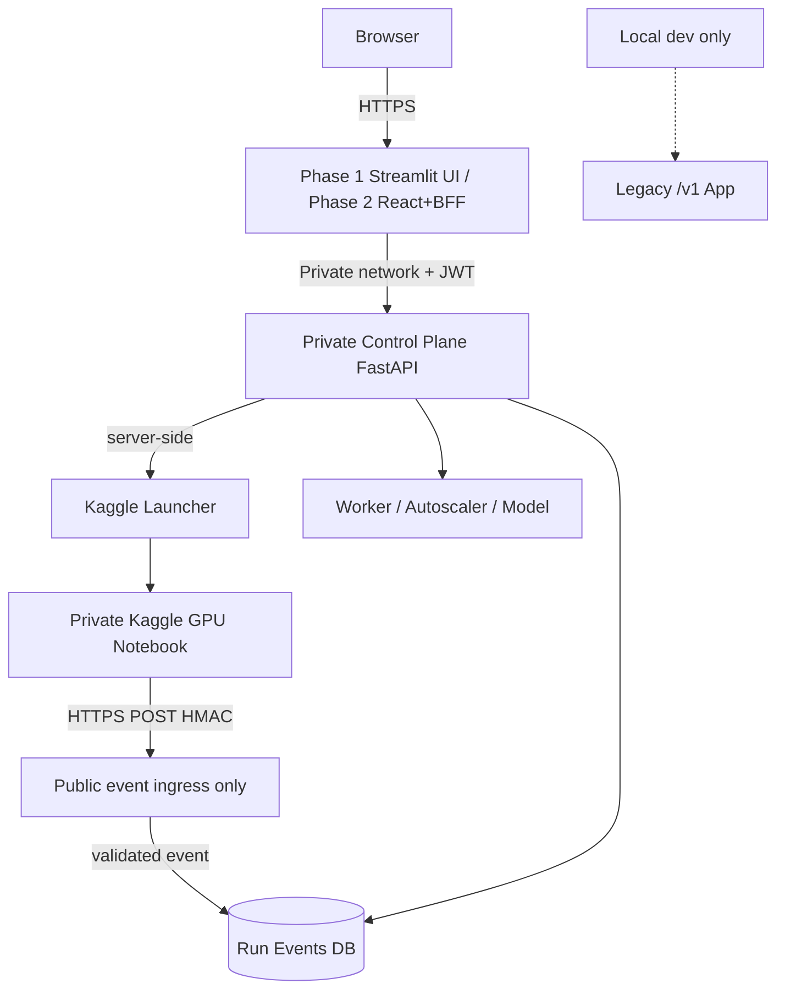
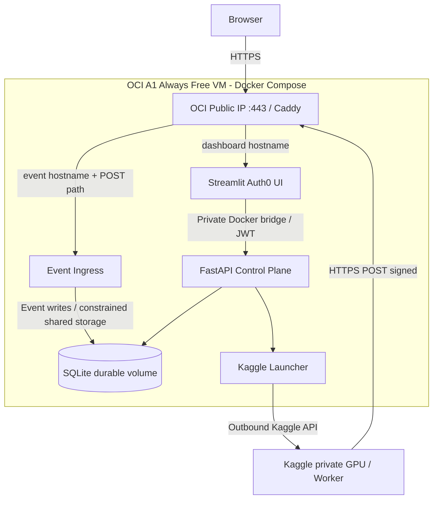

# AOB Phase 1 — 架构设计与 Trust Boundary

> **部署基线 v1.1（2026-11-17）**：明确使用 **Oracle Cloud Infrastructure (OCI) Always Free / Ampere A1 ARM64 / Ubuntu Linux / Docker Compose / 单台公网 VM**；GPU 推理与 Autoscaling 继续留在 **Kaggle**。此设计是拟实施方案，尚未对应用源码完成修改。当前 React+BFF 不在 Phase 1 范围内，先使用 Auth0 保护的 Streamlit 过渡 UI。平台资源按 Oracle 官方当期文档与控制台实际资格核实。详见 `06_OCI_ALWAYS_FREE_DOCKER_DEPLOYMENT.md`。

## ADR-001：拆分公网事件入口和私有控制平面（Accepted for implementation）

**现状**：`api/main.py` 的单个 `FastAPI` 同时挂载 demo router 与全部 `/v1/` 业务路由。Cloudflare Quick Tunnel 转发整个端口会使旧接口意外暴露。

**决定**：
- `Public Event Ingress` 独立 ASGI app/进程/端口，只负责 `POST /api/events`；实现请求签名、限制、数据验证、写事件（同一 DB 可作为单机 Phase 1 过渡，且只有 Ingress 进程有 INSERT 授权/必要连接）。
- `Private Control Plane` 独立 ASGI app/进程/端口，提供最小 `GET /api/me`、Demo Start/Runs/Status/State/Metrics、必要摘要；访问需 Auth0 JWT + 白名单 + owner。它负责 Kaggle CLI，绝不经过 Webhook 公网域名。
- `/v1/*` 留在显式的 `Legacy Dev App`，生产不挂载；未来若要恢复 Worker/Intake 管理接口，须重新定义管理 API、认证权限和业务需求，禁止直接公开旧路由。

## Trust Boundary 细则

| 边界 | 允许 | 禁止 |
|---|---|---|
| Browser → UI | HTTPS 页面、Auth0 跳转 | 公开存放 Kaggle/Event Master Secrets |
| UI → Private Control Plane | 后端发出的已授权请求（Phase 1 暂用 Streamlit 端持有 Access Token） | 绕过 Auth0 直连控制端口 |
| Browser → Public Event Ingress | 不使用；Kaggle Worker 发签名 POST | 任意 GET、控制 API、文档路由 |
| Kaggle → Event Ingress | POST 签名事件，限制类型/体积/时效 | 任意写数据库、访问控制 API |
| Control Plane → Kaggle | 最小权限 Kaggle CLI 控制 | 将 Kaggle Credential/Notebook Key 返回给浏览器 |
| API → DB | 最小权限读取自己 Run 的数据；受限写入 | 发布 DB 文件或未经脱敏的原始数据 |

## ADR-002：BFF 在后续阶段，Phase 1 不引入 Cookie Auth（Deferred）

React + FastAPI BFF 是目标形态，但 Phase 1 优先切断网络暴露和密钥生命周期。Streamlit 过渡服务可以在服务端持有 Auth0 Access Token；**当 React 切换时**再实现 Auth0 Authorization Code + PKCE/BFF、HttpOnly Secure Session Cookie、CSRF 防护、Session rotation、logout revocation。React 只能调用 BFF，不应直接访问 Private API。

## ADR-003：Telemetry 为非可信输入（Accepted for implementation）

Kaggle Notebook 即使是 Private，也应视为权限有限、可能重放/伪造的事件生产者。接受事件依次完成：HTTPS → body cap → HMAC(t+raw-body) → 类型/Schema → DB 中 Active + 未过期 + Key Version 校验 → 幂等 Insert。读取时再次 DTO allowlist，确保已存旧 Event 不泄漏。

## ADR-004：真实 Load Test 不开放通用控制 API（Accepted for implementation）

只保留 `POST /api/demo/start` 的两种固定模式和 units 上限。旧 `/v1/load-tests` 允许任意 arrival/time/fault 等配置，不适合公网供访客调用。所有 GPU/Worker 扩缩容只由已授权 Demo Session 和内部 Worker 控制。

## ADR-005：Event Finalization 交易边界（Accepted for implementation）

Run `complete`/`failed`/`cancelled` 后拒绝任何新事件。Notebook 的 final summary 必须在 Run 标记终态前送达。考虑 Kaggle CLI 可能提前报告 COMPLETE，需要设计 terminal grace / final event 顺序及明确超时归档策略，**不能**为方便迟到指标而永久开放已完成 Run。仅先提交完成时的 final event，然后对 Run finalize，或在服务端明确定义有限的 `finalizing` 中间态（需数据库迁移与测试）。

## ADR-006：代码来源完整性（Accepted for implementation）

`kaggle_launcher.py` 当前 clone `kaggle_scaling` branch。生产用经审核的 exact commit SHA，控制对该 SHA 的发布流程；避免 Kaggle 工作区读写 Token。当前 notebook inject 的 `_AOB_KEY` 是残余风险，Private 与短期有效期只是缓解，不代表密钥从 Notebook 版本历史中消失。

## 安全非功能需求

- TLS 终止 + 仅 HTTPS；代理和应用双重 allowlist。控制平面绑定私网地址、云安全组不开放公网。
- 拒绝时返回固定错误，生产异常不回显 stack trace；日志不得含 Authorization、Cookie、HMAC Header、Notebook Credential。
- SQLite 单主机阶段使用非共享文件系统和备份；多实例部署前需要数据库与任务同步重新设计。
- 预留 `request_id`、`actor_sub`、`run_id`、action、outcome 的结构化审计日志，不写凭证或用户原始请求。
- Public Ingress 维护体积/速率/并发上限；允许必要 Health 探针，但不泄露版本/配置。

## ADR-007：OCI 单 ARM64 VM 作为 Phase 1 运行底座（Accepted for design）

**具体边界**：只给 Caddy 发布 `80:80` 和 `443:443`；`dashboard` 和 `event-ingress` 加入 proxy 网络并只被 Caddy 访问；`dashboard` 再连接 private-control 网络；`control-api` 仅连接 private-control 网络。共享 SQLite 采用独立 volume mount，绝不映射公网端口。SQLite 文件级最小权限与写者协调需要代码落实；容器隔离本身不能替代表级/用户级数据库权限。

**风险**：同一主机失陷可影响多个容器，Compose bridge 隔离不是强安全边界；若需要更严格的安全边界应在未来拆成独立主机/VPC 子网/独立数据库。BFF 不应在尚未实现时被标为 Phase 1 已有防护。
