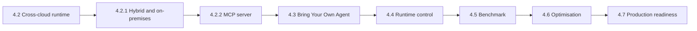

# AOB Product Roadmap — Phase 4.2–4.7

**总体技术与产品路线 | v2.0 | 2026-11-25 | Proposed**

## 1. 产品定位与当前基线

**AOB — Unified Agent & LLM Observability Across Cloud, Local and Private Infrastructure.**

AOB（Agent Ops Board）面向公有云、本地电脑、局域网、企业数据中心及托管机房，提供统一 Agent/LLM 可观测性、运行控制与性能优化。Dashboard、REST API/SDK 和 MCP 是共享服务的三种入口。用户可接入已有 Agent 或 LLM，不要求购买 GPU 或迁移工作负载。目标：将 Agent、Task、Worker、LLM、GPU 与费用关联在同一个 Run 上。基础设施采购、GPU autoscaling、模型缓存优先复用云供应商，而不是重建 GPU Marketplace。

已知历史基础：OCI AOB、Kaggle 双 T4/Qwen3-4B/llama.cpp GPU Demo、Azure Python Agent GHCR 与 OTLP 已有成功验证记录。当前 Phase 4.1 具体完成状态及代码结构须在 Phase 4.2.0 审查；此处不宣称所有计划功能已实现。

安全、隔离、预算与可靠性贯穿全部阶段；4.7 是强化，不是首次引入。

## 2. 分阶段交付总览

| Phase | 目标 | 核心交付 | 退出条件 |
|---|---|---|---|
| 4.2 | Unified Cross-Cloud Runtime | Azure Agent + RunPod llama.cpp + Cached Models + OCI OTLP | 100-task 真执行与关联 trace；按需 GPU 回收和成本可核对 |
| 4.2.1 | Hybrid & On-Premises | Existing Endpoint、通用推理 adapter、出站 Connector、私网遥测 | 本地/LAN LLM 真实接入；无租赁、无需公网入站、数据策略生效 |
| 4.2.2 | AOB MCP Server | 外部 Agent 调用只读观测工具、认证、共享服务、MCP traces | 至少一个真实 MCP 客户端查询 Run；隔离、权限与无收费副作用测试通过 |
| 4.3 | Bring Your Own Agent | 接入已有 Agent 或 GHCR 自助部署；可选 BYOK、报价确认 | 已有资源无需租赁；新收费资源用户确认、隔离及费用归属明确 |
| 4.4 | Interactive Runtime Control | Pause/resume/stop、并发控制、恢复 | 真实 worker 状态与任务恢复证据 |
| 4.5 | Performance Benchmark | 可复现对照测试、真实指标库 | 固定 workload 的可比较性能/成本报告 |
| 4.6 | Intelligent Optimisation Sandbox | 约束下配置推荐、预测置信度 | 用真实测试验证推荐并展示误差 |
| 4.7 | Production Readiness | 强化多租户、审计、SLO、运维与数据治理 | 安全/可靠性/费用验收与运维手册 |

## 3. Phase 4.2 — Unified Cross-Cloud Runtime Integration（P0）

详见独立 `AOB_Phase_4.2_Technical_Design.md`。先调查，再最小改造：

- 4.2.0：源码、部署、持久化、OTLP、安全与测试基线清点；核实 Azure 是否已有部署接口；调查 Hybrid 网络与数据边界、Provider 职责及 MCP 共享查询服务。
- 4.2A/B：统一 Deployment Registry + capabilities；封装现有 Azure 接入，区分 Deployment、Run 与 Replica；分离 DeploymentProvider、InferenceProvider、TelemetryProvider 与 AgentRunClient；预留 external ownership、连接方式及共享授权查询服务。
- 4.2C/D/E：RunPod LB endpoint PoC、自定义 llama.cpp GHCR image、Cached Models GGUF 解析与 cold-start/billing 验证。
- 4.2F/G：Azure Agent 真实调用 RunPod，100 封邮件 workload，跨云 Trace Context 与 GPU 指标关联。
- 4.2H：内置 Live Demo、预算/取消/恢复、历史 Run、受控发布与回滚。

默认已部署的 Agent image、RunPod endpoint 和 OCI 控制面；点击只发起一次 Run，而不是每次重新部署或租赁 Marketplace 主机。GPU 缩容至零由 RunPod 管理。保留 Azure-only、Kaggle 和真实历史记录入口。非目标：用户任意镜像、通用 GPU broker、模型仓库平台、模拟 GPU。

## 3.1 Phase 4.2.1 — Hybrid & On-Premises Integration（P0）

用户可接入家庭 RTX 3060/Mac、公司 LAN GPU、企业数据中心、托管机房、已有 RunPod Endpoint 或 Azure Agent。AOB 不要求重新部署或租赁。支持三种模式：observe-only（仅遥测）、connect-and-execute（经授权执行）、managed deployment（后续按需创建）。注册不等于授权执行；注销外部资源不等于删除资源。

| 子阶段 | 交付 |
|---|---|
| 4.2.1A/B | Existing Endpoint Registry、通用 OpenAI-compatible inference adapter；llama.cpp 优先 |
| 4.2.1C/D | 出站 HTTPS Connector、注册/heartbeat、凭证轮换、撤销、有限控制协议；先 push-only |
| 4.2.1E/F | 可选 GPU collector、推理引擎 metrics adapters；不支持的指标显示 N/A |
| 4.2.1G | 私网数据政策、脱敏、有限缓冲、重试去重、安全出站；禁止任意代理 |
| 4.2.1H/I | 本地/LAN 实际执行、OCI 观测、Dashboard 统一接入、费用模型 |

验收：本地 Agent 调用私网 LLM；OCI 仅接收授权遥测；不租 GPU、不开放公网入站、不需要 GHCR 或云管理 key；连接撤销与离线状态真实可见。无出网许可的企业等待私有化 AOB。自有硬件/托管费用可按用户提供的内部费率估算，未知成本不显示为零。

## 3.2 Phase 4.2.2 — AOB MCP Server（P0）

让外部 Agent 使用 AOB 分析其他 Agent 的运行。独立 MCP 访问层复用已有 application services，Dashboard/REST/MCP 共用租户权限、审计、数据与状态模型。首版只读，不需要额外 LLM/GPU。

| 子阶段 | 交付 |
|---|---|
| 4.2.2.0/A | 服务与授权调查、MCP SDK skeleton、协议版本验证 |
| 4.2.2B/C | 共享服务 adapter；list_runs、get_run_summary、get_run_trace、get_failed_tasks、get_llm_metrics、get_gpu_metrics |
| 4.2.2D/E | 结构化输出、分页/限制、脱敏；OAuth audience/scope、租户与资源授权、限流审计 |
| 4.2.2F | MCP 调用 OTel trace 与自观测，防递归及敏感数据泄漏 |
| 4.2.2G/H/I | OCI staging、Streamable HTTP、客户端兼容测试及文档 |

验收：至少一个真实 MCP 客户端能够查询运行数据；跨租户、过期凭证、越权查询被拒绝；查询不创建资源、不触发推理。4.4 之后才开放运行控制；4.5/4.6 增加 benchmark/优化工具；付费工具需服务端授权与预算绑定，不依赖模型声明同意。可并行规划但不阻碍 4.2 基础 Demo 验收。

## 4. Phase 4.3 — Bring Your Own Agent（P0）

提供两条平等的用户入口：**Connect Existing Agent / LLM** 和 **Deploy Your Agent**。前者复用 4.2.1，已有本地、LAN、托管机房、公有云资源直接注册，observe-only 不需 LLM key 或 GPU 报价；执行则要求用户授权对应 endpoint。后者仅在确实需要新算力时进入 BYOK、资源报价与确认流程。已有收费 endpoint 也应确认调用预算，不能将免租新 GPU 等同于免推理费用。

对于新部署，用户输入 GHCR image（优先 digest）、Agent CPU/GPU 要求、推理 provider/model、最长运行时间、预算；AOB 校验镜像架构及 runtime contract，推荐配置并显示预计费用，用户显式确认后才创建收费资源。镜像地址不足以推断显存或并发，需要用户声明。RunPod Serverless 报价为费率与预算估算，不是保证某台主机价格。若未来支持 Vast Marketplace，另行处理 offer 有效期、库存变化及租赁确认。

| 子阶段 | 交付与验收 |
|---|---|
| 4.3A | GHCR registration，公开/私有镜像验证，固定 digest，不自动构建任意代码 |
| 4.3B | BYOK，provider/registry credentials 加密、最小权限、删除轮换；用户账户支付 |
| 4.3C | Resource requirements + quote，明确 CPU/GPU/存储/网络、计费单位、上限估算、到期时间 |
| 4.3D | Quote approval，绑定 user/config/digest/rate/expiry，幂等；价格或配置超授权须重新确认 |
| 4.3E | 隔离执行环境、配额、受控出站、资源所有权、超时清理；不可信镜像不得执行在 OCI 控制面 |
| 4.3F | Runtime contract：start/status/cancel（可选 capabilities）、OTLP、health、结果契约；无 instrumentation 不显示虚假应用指标 |
| 4.3G | 独立 Deployment/Run History，tenant RBAC、审计、数据隔离测试与费用核对 |

建议先复用 4.2.1 已有资源接入，再开放自助部署：降低第三方代码执行风险。基础租户隔离必须在开放第一位外部用户前完成。用户预算是授权与估算边界，不保证供应商硬性账单上限。

## 5. Phase 4.4 — Interactive Runtime Control（P1）

核心是 Agent Worker 控制，不重新实现 RunPod autoscaling。先在可信内置 Agent 上完成，再通过 capabilities 支持用户 Agent。

| 子阶段 | 交付与验收 |
|---|---|
| 4.4A | Worker registry/heartbeat；真实状态、最后更新时间、Run 归属 |
| 4.4B | Pause 停止接收新任务并 drain；Resume 恢复；操作有权限和幂等性 |
| 4.4C | Stop/Kill 明确区分；lease/ack/requeue、attempt、幂等业务写入；测试丢失 worker |
| 4.4D | 调节并发/worker 数；关联 queue backlog、LLM load 和 GPU replica 曲线 |
| 4.4E | 受控 failure injection（仅 demo/staging），timeout、retry、recovery trace、操作审计 |

MCP 扩展：共享控制服务稳定后再开放 pause_worker / resume_worker / stop_worker 等工具；独立 scope、幂等、操作审计与授权，未支持控制接口的外部 Agent 保持只读。

退出条件：暂停/关闭真实 worker，任务不丢失，重复执行有防护，用户可追踪任务重新分配；GPU 数量变化仅显示真实观测，不保证每次 worker 增加都触发 GPU 扩容。历史 Run 不可被改写。

## 6. Phase 4.5 — Performance Benchmark（P1）

构建可重复的试验流程与 Benchmark Database，而不是只比较 GPU 理论 TFLOPS。

- 4.5A：固定 workload、输入版本、model revision/quantization、engine commit、prompt、输出限制、验证规则；记录 GPU 型号、显存、region、worker slots、agent concurrency、cache/cold/warm 状态。
- 4.5B：执行多次测试、随机化/控制干扰，记录样本数量、P50/P95、吞吐、错误率、准确率或业务验证成功率。
- 4.5C：成本按实际计费区间与费率估算/对账；单位成功任务成本、启动开销、空闲费与失败重试费用独立。
- 4.5D：Run comparison、趋势与版本差异分析；不同模型/输入不直接当等价样本比较。
- 4.5E：Benchmark suite 与可复现报告，执行新测试前明确授权预算。

增加本地、LAN、托管机房与公有云的对照试验；成本口径区分租赁、内部费率与实际账单；MCP 可先读取 benchmark 结果，发起收费试验需要授权。

退出条件：至少两种受支持配置、每种多次重复、同一固定 workload 的真实数据可复现；缺失遥测明确标注。Serverless GPU 型号选择受库存与平台支持限制，不承诺任意 Marketplace 型号可用。

## 7. Phase 4.6 — Intelligent Optimisation Sandbox（P2）

用户输入任务数、deadline、budget、最小质量目标；系统基于真实 Benchmark 推荐可行配置，而非凭空推断。

| 子阶段 | 交付 |
|---|---|
| 4.6A | Workload profile 与数据充分性检查，区分冷/热启动及业务输入分布 |
| 4.6B | 候选配置枚举和约束过滤；成本与延迟预测，保留质量门槛 |
| 4.6C | 推荐最低预计成本或最快配置，显示置信区间、假设、风险和备选 |
| 4.6D | 用户批准后验证推荐，用新 Run 更新数据和预测误差 |
| 4.6E | 可选 what-if 模拟；明确标记模拟，不能当作真实 GPU benchmark |

优化候选包含已有私有算力，遵守数据驻留/网络约束；MCP 可提供只读推荐工具，不自动执行收费建议。

验收示例：针对1000封邮件、60秒期限与预算上限，如果没有充分证据则输出“无已验证可行配置”或建议小规模测试，不承诺一定完成。业务质量、失败率与冷启动计入约束。优化结果先推荐、后确认，不擅自提高费用或改模型。

## 8. Phase 4.7 — Production Readiness（P2，基础能力提前）

| 工作流 | 验收要求 |
|---|---|
| Tenant isolation / RBAC | 跨租户资源与 trace 访问拒绝；最小权限测试 |
| Runtime isolation | 独立执行环境、镜像安全策略、凭证隔离、资源限额与出站策略 |
| Cost governance | 并发/日月预算、授权审计、对账、异常告警，明确估算与真实账单 |
| Reliability | SLI/SLO、故障演练、重启恢复、备份恢复、幂等、供应商降级 |
| Data governance | Prompt/response 脱敏、保留/删除策略、region 与访问审计 |
| API/SDK/MCP | 版本化 runtime contract、工具 schema、文档、兼容性测试与权限审计 |
| Enterprise deployment | 私有化 AOB、无外网模式、Connector 生命周期、企业代理/证书和数据驻留验证 |
| Release/Operations | staging/canary、回滚、运营手册、监控与 incident response |

退出条件：生产前独立安全审查和受控负载/成本验收；不能因为 Demo 成功就宣称 production-ready。

## 9. 产品页面演进与边界

| 页面 | 首次交付 |
|---|---|
| Live Demo / Agent / LLM / GPU Observability / Run History | 4.2 增量改造现有页面 |
| Deployments / Connect Existing Agent / Cost Estimate | 4.2 内部注册，4.2.1 已有端点接入，4.3 自助部署 |
| Hybrid Connectors / Endpoint Registry | 4.2.1 |
| MCP Tools / MCP Observability | 4.2.2 只读与基础自观测，后续按能力扩展 |
| Runtime Control | 4.4 |
| Benchmarks / Run Comparison | 4.5 |
| Optimisation Sandbox | 4.6 |
| Tenant Admin / Audit / Governance | 4.3 基础，4.7 强化 |

产品闭环：Deploy → Execute → Observe → Analyse → Optimise → Execute Again。不要在没有用户需求证据时把所有页面一次性开发；每阶段通过退出条件后再评估下一步。

## 10. 当前立即行动

1. 将 Phase 4.2 技术设计加入项目 docs 目录，让 Copilot 首先执行 4.2.0 并输出 discovery report。
2. 单独验证 RunPod Cached Models + llama.cpp Load Balancing PoC，确认实际费用和 cold-start。
3. 复用现有 Azure Agent 与 OCI 接收链路完成真实 Live Demo；4.2 只预留 Hybrid/MCP 接口，不提前实现 Connector 或 MCP。
4. 依次完成 4.2.1 已有私网/云端资源接入、4.2.2 只读 MCP，再进入 4.3 用户自助部署。

本路线以当前讨论为规划基线，并未审查实际仓库、部署或账单。具体 Phase 编号为拟议规划；实际任务范围以调查结果、供应商可用能力及用户授权预算为准。外部能力参考详见 Phase 4.2 技术设计末尾官方文档链接。
