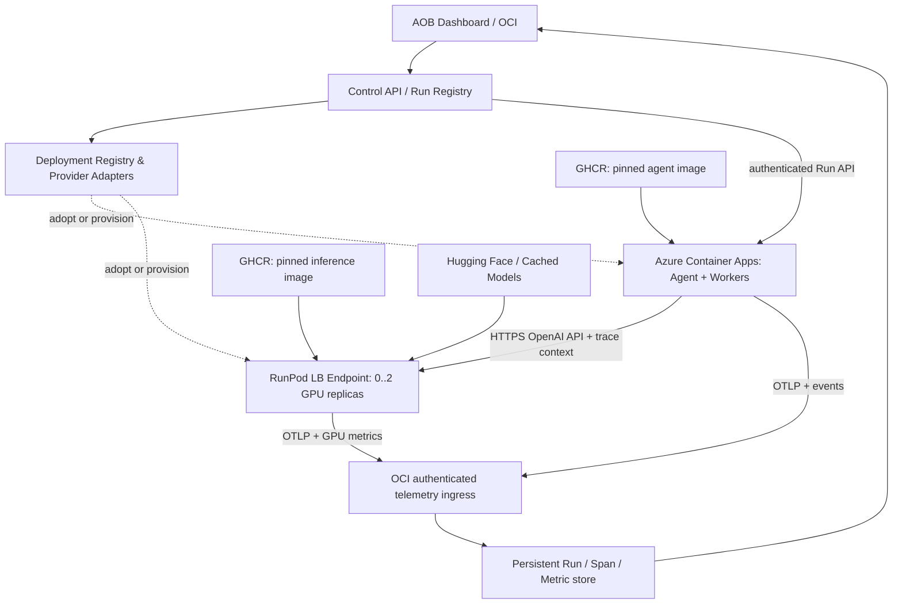
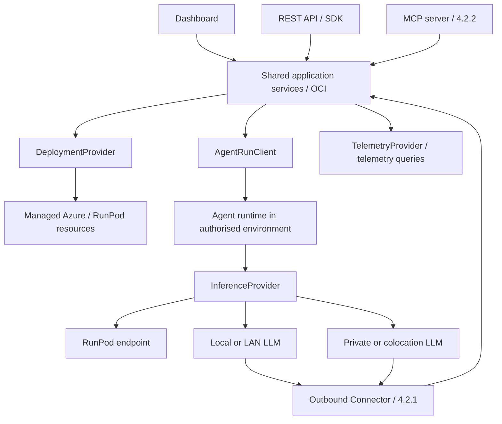
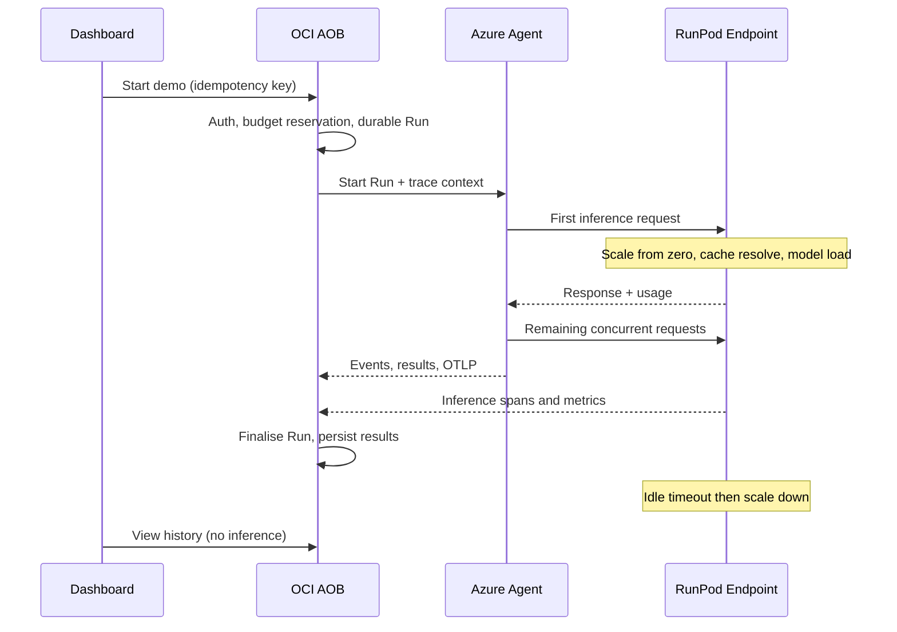

# AOB Phase 4.2 — Unified Cross-Cloud Runtime Integration

**技术设计与实施任务书 | v2.0 | 2026-11-25 | Proposed / 待源码审查与 PoC 验证**

适用项目：`agent-ops-board`；目标读者：项目维护者与 GitHub Copilot coding agent。

## 修订说明（v2.0）

产品定位：**AOB — Unified Agent & LLM Observability Across Cloud, Local and Private Infrastructure.**

新增 Phase 4.2.1（Hybrid & On-Premises Integration）及 Phase 4.2.2（MCP Server）。4.2 只为这些阶段建立接口和数据模型边界，不提前实现 Connector 或 MCP Server。已有云端或私有 LLM 可直接注册使用，购买 GPU 不是接入 AOB 的前提。原有 RunPod PoC、Azure/Kaggle 回归及成本控制要求保持有效。

## 1. 目标与范围

在不破坏现有 Kaggle、Azure Agent 和 OCI Dashboard 的前提下，支持 Azure CPU Agent 调用 RunPod Serverless 上的 llama.cpp/Qwen3-4B，使用 RunPod Cached Models，GPU 空闲缩容至零，并在 OCI AOB 中关联端到端遥测。内置 Demo 使用预先发布的固定镜像，不在用户点击时构建镜像。保留未来用户自带 GHCR 镜像、报价确认、BYOK 的扩展点，但本阶段不开放不可信第三方镜像执行。

当前已知基线（来自项目历史讨论，非本次源码核实）：OCI ARM64 上独立 AOB 已部署，域名 `aob.dipperwoven.com`；Azure Python Agent 已通过 GHCR 部署并向 AOB 发送 OTLP，曾观察到 TRACE_COMPLETE、405 spans；Kaggle 双 T4 已运行 Qwen3-4B-Instruct-2507 Q8_0、llama.cpp 与 Worker/GPU 扩缩容。Phase 4.1 的确切完成情况、当前分支、数据库及所有路由仍须调查。不要将 MarcheAgents 的独立生产 BFF 与 AOB 实例混为一谈。

### 1.1 架构决策

- ADR-01：Agent 与推理运行时分离；Azure 运行可信 Agent，RunPod 仅运行推理服务，OCI 保留控制与观测。OCI 不执行普通用户任意代码。
- ADR-02：统一的是 Deployment Registry、接口契约及身份/状态映射，不强迫 Azure、RunPod、Kaggle 具有相同控制语义。先 adopt 现有资源，再考虑自动 provision。
- ADR-03：Deployment 是长期存在的资源配置；Run 是一次业务执行；Replica/Inference Worker 是供应商管理的短期资源。Run 结束不等于删除 Endpoint。
- ADR-04：保留 llama.cpp 与当前 GGUF Q8_0，不默认切换 vLLM 或 Q4。模型通过 Cached Models 提供，镜像不含权重；若 PoC 失败再评估 Network Volume。
- ADR-05：采用 RunPod Load Balancing Endpoint 直接提供 HTTP/OpenAI 兼容接口；不自行实现 GPU 租赁或跨主机调度器。GPU autoscaling 由 RunPod 决定。
- ADR-06：现阶段内置 Demo 仅白名单用户可触发收费执行，默认功能开关关闭；历史结果可按既有权限浏览。

- ADR-07：分离 DeploymentProvider、InferenceProvider、TelemetryProvider；AgentRunClient 单独保留。部署资源、调用推理、采集遥测为独立能力，不要求每个 Provider 实现全部接口。
- ADR-08：支持 managed（AOB 创建并明确拥有生命周期）、external（用户提供、仅注册/连接）资源；另设 observe-only 与 execute 权限。外部资源不得因 Run 结束、注销或 AOB 故障被删除。
- ADR-09：未来私网 Connector 采用出站连接；业务 Agent 与 LLM 优先在同一信任域运行；默认仅脱敏遥测出网，禁止任意网络代理及公网暴露 LLM。
- ADR-10：Dashboard、REST API 与 MCP 共享 application services、授权与审计；不允许 MCP 直连数据库或绕过业务权限。4.2 不增加公开 MCP 服务。

## 2. Phase 4.2.0 — 改造前调查（必须先执行，只读）

### 2.1 源码与部署清点

在本地 PowerShell/Codespaces 的实际仓库根目录执行以下只读命令；不要把命令输出中的凭证提交到 Git。

```bash
git status --short --branch
git branch --show-current
git log -8 --oneline
git remote -v
git ls-files
git grep -n -E 'azure|containerapp|ghcr.io|kaggle|runpod' -- '*.py' '*.yml' '*.yaml' '*.toml'
git grep -n -E 'OTEL|traceparent|source_id|run_id|TRACE_COMPLETE' -- '*.py'
git grep -n -E 'llama-server|CUDA_VISIBLE_DEVICES|gpu_instance_|check_model|GPU Manager' -- '*.py' '*.ipynb'
git grep -n -E '(/api/demo/start|/api/demo/runs|/v1/dashboard|/api/me)' -- '*.py' '*.ts' '*.tsx'
git grep -n -E 'requirements.lock|pip install|opentelemetry-proto' -- '*Dockerfile*' '*.yml' '*.yaml' '*requirements*'
```

输出 `docs/phase4.2/discovery.md`：实际文件路径、函数/类名、当前行为、证据（commit + 文件行号）、复用/修改/新增建议。核对：Azure 部署究竟由 GitHub Actions、CLI、手动 Portal 还是 AOB API 完成；GHCR 是镜像来源还是已有注册接口；不要因为 Azure 已运行就假定 AOB 已具有自动部署 API。

| 调查对象 | 必须回答的问题 |
|---|---|
| Dashboard/BFF | Streamlit 或 React 实际入口？Start 请求路由、权限、刷新方式？是否存在旧的 404 路由？ |
| Control API | Run 创建与状态机、取消、幂等、source 注册、Kaggle 启动耦合在哪里？ |
| Azure Agent | Dockerfile、镜像 tag/digest、CPU 架构、Run API 合约、任务队列、LLM client、并发方式、退出和重试语义？ |
| Kaggle | Notebook bootstrap、模型仓库/文件/revision、llama.cpp 版本、GPU routing、任务数据和验证逻辑有哪些可复用？ |
| Telemetry | OTLP HTTP/gRPC、protobuf 依赖、认证、Span 数据结构、事件去重、数据持久化、trace complete 判定？ |
| OCI deployment | Compose 文件、网络、卷、代理、TLS、ARM64 镜像、现行 secret 挂载和资源限额？ |
| Persistence | Run/Span/Event/Metric 实际存储和 retention；迁移工具、事务、索引、重启恢复、历史读取？ |
| Tests | 现有命令、fixture、外部调用 mock、回归基准、CI 架构矩阵？ |

OCI 只读检查（先确认实际 Compose 项目路径）：`docker ps --format '{{.Names}} {{.Image}} {{.Status}}'`；`docker inspect <container> --format '{{range .Mounts}}{{println .Source "=>" .Destination}}{{end}}'`；`docker stats --no-stream`；只列出环境变量名称，不打印值。不要运行会泄漏 secrets 的完整 inspect 或 compose config 输出到报告。

Azure 只读：确认当前 subscription/resource group/app；使用 `az containerapp show -g <rg> -n <app> --query '{name:name,image:properties.template.containers[0].image,revision:properties.latestReadyRevisionName,fqdn:properties.configuration.ingress.fqdn}'`；记录资源 ID、revision、镜像版本、运行端点、认证方式。检查是否有可独立测试的 staging app。

### 2.1.1 新增调查：Hybrid 与 MCP 的架构预留

以下只读调查必须写入 discovery.md，并给出真实路径、行号、调用图、现有能力与缺口。不得输出密钥或敏感 payload。

```bash
git grep -n -E 'LLM_BASE_URL|base_url|OpenAI|InferenceClient|DeploymentProvider|TelemetryProvider|AgentRunClient' -- '*.py'
git grep -n -E 'tenant_id|owner_id|source_id|audience|scope|authorize|require_auth' -- '*.py'
git grep -n -E 'FastAPI|APIRouter|Depends|websocket|heartbeat|polling|NVML|pynvml' -- '*.py'
git grep -n -E 'prompt|completion|response_body|redact|sanitize|traceparent' -- '*.py'
```

| 调查 | 必须产出的决策证据 |
|---|---|
| Provider 职责 | 列出现有部署、Run 控制、推理调用、遥测读写接口；识别 Kaggle 或 Azure 硬编码；提出最小兼容拆分，不重写已可用服务 |
| Existing resources | 注册已有 Azure Agent、RunPod Endpoint、外部 OpenAI-compatible LLM 是否需要镜像或创建资源；区分 ownership、连接模式、能力与权限 |
| 网络边界 | OCI 公网、Azure、RunPod 与本地/LAN/托管机房的可达性；私网地址不能由 OCI 任意探测；评估 Connector 出站 HTTPS、认证与命令白名单 |
| 数据边界 | 查明 prompt、response、邮件内容、trace attributes、错误日志的实际流向；确定默认脱敏及 observe-only 入口 |
| MCP 可复用层 | 找出 Dashboard 是否直接读 DB；列出可复用的 Run/Trace/LLM/GPU 查询服务、分页、序列化、租户校验与错误模型；评估 Auth0 audience/scope，避免复用浏览器 cookie |
| 兼容与测试 | 设计 external endpoint 无 provision/delete、未知 metrics、无 GPU、禁止跨租户、只读查询无推理副作用的测试；用 fake adapter 验证扩展点 |

调查输出额外包含 Provider capability matrix、managed/external ownership matrix、网络及数据流图、MCP tool→service→permission 映射、ADR 与后续阶段 backlog。不得在调查阶段搭建 Connector/MCP 或调用付费资源。

### 2.2 基线与回归证据

1. 使用实际仓库文档确定测试命令，运行现有 unit/integration tests，记录通过/失败/跳过数量；不得声称固定历史测试数量仍然有效。
2. 运行一次现有 Azure Agent 100-task Demo（若产生费用须先授权），核对 Run 状态、任务结果、Span 数量与父子关系；保存脱敏结果。
3. Kaggle 可用时做已有功能 smoke test；不可用则使用既有真实 fixture/历史记录做协议回归，并标明 live 未验证。
4. 保存部署版本、数据库 schema、备份及恢复步骤；建立独立开发分支和 feature flag；不得直接修改正在运行的 OCI release。

### 2.3 调查关卡 G0

提交 discovery.md、现状图、差异矩阵、基线测试记录及拟议变更清单。明确哪些功能已存在、哪些仅计划、哪些需供应商 PoC。只有明确 Azure 资源管理方式及现有运行接口后才确定重构范围。禁止未经批准创建收费资源。

## 3. 目标架构与生命周期



部署平面（低频）：镜像发布、资源创建/更新、配置、凭证轮换。运行平面（高频）：点击 Demo → 创建 Run → Azure Agent 执行 → 调用 RunPod endpoint → GPU 自动启动/扩容 → 保存结果 → 空闲缩容。观测平面：OCI 接收两端遥测，按 Run 和 Trace 关联；历史页面不调用推理端点。

### 3.1 三种资源状态不可混淆

| 实体 | 建议状态 | 结束行为 |
|---|---|---|
| Deployment | REGISTERED, PROVISIONING, READY, DEGRADED, DELETING, DELETED | 仅显式管理操作删除资源 |
| Run | QUEUED, STARTING, RUNNING, FINALISING, SUCCEEDED, FAILED, CANCELLED, TIMED_OUT | 停止新任务，持久化结果，允许推理空闲回收 |
| Inference replica | UNKNOWN, INITIALIZING, READY, BUSY, DRAINING, RELEASED | 供应商管理；状态来源/时间必须标注 |

Deployment READY 指配置可用，不等于 GPU 已加载模型；Run 完成不等于 GPU 已释放。未知供应商状态保留 UNKNOWN，不能显示为零 GPU。Run 终态和遥测完整度分开，允许迟到 spans。

### 3.2 后续目标架构（4.2 仅预留）



图为逻辑职责，不代表 OCI 可以直接路由私网请求。InferenceProvider 在实际执行域调用 LLM；私有推理场景优先将 Agent 放在私网，Connector 只上报允许的遥测并接收有限控制指令。已有公网 HTTPS endpoint 也可采用直接访问，但需授权及目的地址策略。MCP 查询仅通过共享服务读取存储数据，不触发推理。

## 4. Phase 4.2A — 统一部署注册与接口

优先建立最小抽象，保留原接口兼容层。建议实体字段（按实际数据库实现调整）：

- Deployment：deployment_id、owner_id、provider、runtime_type(agent/inference)、image_ref、image_digest、provider_resource_id、endpoint_ref、credential_ref、config_version、status、created_at。
- Run：run_id、owner_id、agent_deployment_id、inference_deployment_id、source_id、workload_id、config_snapshot、status、deadline_at、cancel_requested、telemetry_status。
- Operation：operation_id、idempotency_key、resource_id、operation_type、state、attempts、last_error_code、updated_at；管理操作可审计。
- Capability：supports_provision、supports_run、supports_cancel、supports_metrics、supports_scale_config；不支持时明确返回错误或禁用 UI。

拟议 API（先核对既有路由，不强制改名）：

| 方法/路径 | 语义 |
|---|---|
| POST /api/v1/deployments | 注册已有资源或创建资源配置；默认 adopt，不产生新收费资源 |
| GET /api/v1/deployments/{id} | 获取状态与能力 |
| POST /api/v1/deployments/{id}/validate | 验证配置及权限；禁止隐式 GPU 推理 |
| POST /api/v1/runs | 创建一次 Run，202 + run_id；幂等 key |
| GET /api/v1/runs/{id} | Run 状态及关联部署 |
| POST /api/v1/runs/{id}/cancel | 取消业务 Run，不自动删除共享 Endpoint |
| GET /api/v1/runs/{id}/telemetry | Trace/Event/Metric 查询，分页 |

接口分离示意：

```python
class DeploymentProvider(Protocol):
    async def inspect(self, resource_ref): ...
    async def provision(self, spec, operation_id): ...
    async def delete(self, resource_ref, operation_id): ...
    async def capabilities(self): ...

class AgentRunClient(Protocol):
    async def start_run(self, run_context): ...
    async def cancel_run(self, run_id): ...
    async def get_run_status(self, run_id): ...

class InferenceProvider(Protocol):
    async def complete(self, request, trace_context): ...

class TelemetryProvider(Protocol):
    async def get_health(self, resource_ref): ...
    async def get_metrics(self, resource_ref, time_range): ...

# InferenceClient may remain a compatibility name for existing callers.
# OTLP ingestion remains a separate authenticated push path.
```

新增建议字段：`ownership` (managed/external)、`connection_mode` (public_https/private_connector/push_only)、`execution_policy` (observe_only/execute)、`connector_ref`（可空）、`capabilities`、`telemetry_policy_ref`（可空）。external deployment 不要求 image_ref 或 provider 管理凭证；provider_resource_id 可空。DeploymentProvider 不负责推理和遥测；TelemetryProvider 的 pull 能力可选，已有 OTLP push 无需实现 pull。服务端按资源 ownership、capability 和权限判断可执行操作；external 仅解除注册，不删除供应商资源。连接验证默认仅使用管理面/非推理健康接口，observe-only 不触发 GPU。私网 Connector 未实施前返回明确 NOT_SUPPORTED，不创建通用代理。

为 MCP 预留稳定查询服务（list_runs、get_run_summary、get_run_trace、get_llm_metrics、get_gpu_metrics、get_failed_tasks），统一 tenant/source/run scope、分页、结果上限、脱敏、错误码、数据时间及 provenance。4.2 优先复用现有读服务；不要求新增所有查询路由，也不创建 MCP endpoint。测试 fake external provider 无部署能力仍可被注册和查询，且禁止删除/收费操作；已有 Dashboard 与 API 共用授权逻辑。

Azure Adapter 对应已有 Container App 管理/运行接口；RunPod Adapter 对应 Endpoint 管理和指标；Kaggle Adapter 保持现有启动逻辑。禁止把 RunPod 的一次 HTTP inference 请求伪装成 Azure Agent 的 start_run。第一版可仅实现 inspect/adopt；自动资源创建若无必要延期。数据库迁移采用 additive 方式，旧 Run 可读，旧 API 回归通过。G1：注册两种资源、重复请求不重复创建、未知 provider/不支持操作有明确错误。

## 5. Phase 4.2B — Azure Provider 封装与 Agent 基线

复用现有 Azure Python Agent GHCR image 与 Run API；以实际代码为准，将硬编码配置移入已有配置层。通过环境变量或 secret refs 设置 LLM_BASE_URL、LLM_MODEL、LLM_API_KEY/代理凭证，保留既有 RUN API token、OTLP source token 的命名与作用域。Azure 私有 GHCR 使用最小 read:packages 凭证；镜像锁定 digest 或唯一 commit tag。确认 ARM64 OCI 与 amd64 Azure 镜像架构差异。

先以 deterministic/no-LLM 模式跑现有测试，再增加可选 OpenAI-compatible client；连接/读取超时有界，限制并发和输出 token；429/503 仅在安全条件下有限退避重试，避免重复业务写入。取消时停止新任务消费、尽力取消进行中请求、记录取消状态。若现有 Azure Agent 不支持 Worker pause，不在本阶段强行重写 scheduler。

G2：现有 Azure-only Run 和历史记录不受影响；可通过配置选择 inference provider；凭证不出现在日志、镜像、UI 或 trace。

## 6. Phase 4.2C/D/E — RunPod PoC、llama.cpp 镜像与 Cached Models

### 6.1 先做供应商可行性验证（独立于 AOB 改造）

在 RunPod 控制台创建受限测试 endpoint（需用户授权费用）：Load Balancing、1 GPU/replica、active workers=0、max workers=1 起步、idle timeout 初始 30–60 秒、FlashBoot 若适用启用。选择实际可用且 CUDA 兼容的 ≥12GB GPU，先验证 VRAM 峰值与并发，再调整至 max=2。不要假定低价 Marketplace RTX 3060 与 Serverless GPU 价格相同。记录 GPU 类型、区域、实际时价、容器存储费、账户预算限制。不开启无上限自动充值。检查 RunPod 最新端口/超时/API schema 和实际可用选项。

### 6.2 镜像构建

建议新增独立 `inference_runtime/`（实际路径经 G0 确定）：Dockerfile、entrypoint、model_resolver、HTTP gateway/health、telemetry、tests。镜像 `ghcr.io/<owner>/aob-llama-serverless:<commit>`，linux/amd64；固定 CUDA runtime、llama.cpp commit、Python lockfile，CI build + scan + publish，运行非 root（兼容时）；不含权重和密钥。已有 Azure Agent 镜像保持独立。使用 NVIDIA 驱动兼容矩阵与实际 GPU smoke test 验证预编译 binary。

### 6.3 模型缓存与就绪

从 Kaggle 实际配置确认 Hugging Face repo ID、revision、GGUF 文件名及 SHA256；不要猜测 repo 名。RunPod Model 字段配置该 repo；自定义 worker 从 `/runpod-volume/huggingface-cache/hub/models--<org>--<repo>/snapshots/<revision>/` 解析精确文件，检查文件存在、可读、大小、校验与格式；不要取第一个 glob 文件，避免多个量化版本混淆。确认平台是否下载整个 repo、是否允许锁定 revision/选择文件；若平台不能锁定 revision，校验后拒绝不匹配版本。缓存不可用时失败并记录明确原因；不得静默拉取未知版本或未经批准启用收费下载。备选 Network Volume 仅在缓存 PoC 失败后评估。

建议启动流程：HTTP gateway/health 先启动 → resolve cache → llama-server 绑定 localhost:8080 → GPU offload、模型 load → health ready → 路由推理。`PORT` 与 `PORT_HEALTH` 按 RunPod 当前模板要求设置，/ping 初始化返回 204、可服务返回 200；是否要求独立端口在 PoC 确认。外部 `/v1/chat/completions` 由 gateway 转发并保留流式响应、trace headers、错误码；不得开放内部 llama-server 管理端口。启动失败及时退出，避免无限初始化。

```bash
# 示例：参数需按实际 llama.cpp 版本及 VRAM 测试调整
llama-server -m "$MODEL_PATH" --host 127.0.0.1 --port 8080 \
  -ngl 99 --ctx-size 8192 --parallel 4 --metrics
```

注意 ctx-size 与并行 slot 的有效上下文关系；先验证每 slot 的实际容量，避免截断或 OOM。

### 6.4 API smoke test

```python
import os
from openai import OpenAI
client = OpenAI(
    base_url=os.environ['LLM_BASE_URL'],
    api_key=os.environ['LLM_API_KEY'],
    timeout=180.0, max_retries=0,
)
r = client.chat.completions.create(
    model=os.environ['LLM_MODEL'],
    messages=[{'role':'user','content':'Return JSON: {"intent":"test"}'}],
    max_tokens=64, temperature=0,
)
print(r.choices[0].message.content, r.usage)
```

LB URL 形如 `https://<endpoint-id>.api.runpod.ai/v1`，具体鉴权/模型 alias/流式语义以实际测试为准。只从环境变量获取凭证。测量至少 3 次冷启动、3 次热请求、一次缓存未命中（如可观察），记录 client wall time、等待 worker、模型 load、TTFT、tokens/s、账单增量；不得将所有延迟视为 GPU 时间。监控请求自身是否触发扩容，优先使用供应商管理面指标而非持续调用业务端点。

G3：成功读取正确 GGUF、GPU offload 经日志验证、API 返回真实结果、idle 后实际 active GPU workers 为 0（或明确记录不可证实）、无无限重启、账单核对。若 LB 或缓存无法满足，保留 Azure-only Demo，提出 Queue-based adapter 或 Network Volume 的最小替代方案，不直接切换 vLLM。

## 7. Phase 4.2F — Azure Agent + RunPod 集成

先手动预部署并注册两端资源；点击 Live Demo 不创建/删除 Endpoint，不重新拉取 Agent 镜像。Controller 创建 run_id、锁定两个 deployment 版本及测试数据版本，调用已有 Azure Run API。Azure Agent 使用配置中的推理 URL，通过 RunPod 第一次请求触发 GPU。



测试 workload：复用固定100封邮件/Unit ID，先 2 agent workers，再 4/8（若资源允许），验证输出 schema、结果覆盖、重试、幂等。不得用预验证 check_model 的少量调用替代主 workload 的100次调用遥测。RunPod 每个 GPU replica 有并行 slots，Agent 并发增长不保证增加 GPU 数量；需要真实压力测试才确认横向扩容。用户取消时停止新请求，有限等待在途请求；LB 不保证已接受请求立即取消；Run 结束后不再发 inference health probes。

G4：100 Units 均有最终状态，真实 LLM 调用与对应 Unit 可查询；Azure-only 和 Kaggle 保持兼容；没有重复启动或未授权调用。

## 8. Phase 4.2G — 端到端 OpenTelemetry 与 GPU Observability

- 传播 W3C traceparent/tracestate（验证 RunPod LB 是否透传；不透传则采用经验证的关联 ID，不冒充完整分布式 trace）。跨进程使用 OTel propagator；Agent 的 client span 与 GPU gateway server span 相连；每 Unit 记录 attempt、worker_id、inference request ID。跨云时钟同步，duration 使用 monotonic clock。
- 属性命名遵循实际 OTel GenAI semantic conventions 版本及现有 AOB schema；自定义 `aob.run_id`、`aob.unit_id`、`aob.deployment_id`、`aob.source_id`。敏感输入/输出默认不记录；metric 标签避免 unit_id/trace_id 等高基数值。
- 采集 llama.cpp 请求延迟、usage、排队/slots（若 exporter 暴露）；NVML 获取 GPU UUID、型号、util、VRAM，温度若有权限。GPU worker ID 与 Agent worker ID 独立。单次推理归属具体 replica 仅在 gateway 能验证时显示。
- Provider 指标用于观察 endpoint replica 数量/状态；先验证官方 API 能否查询 LB worker metrics、采样间隔与延迟。不可用则显示 unknown，以本地 heartbeat/worker spans 作为观测补充，不推断计费终止。
- GPU 采样是 worker 时间窗口的数据，不等于每 Unit 的 GPU 使用率。每个数据源标注 measured / provider-reported / estimated / unavailable。Run 跨共享 endpoint 时不能把所有 GPU 成本无条件归属一个 Run。
- OTLP 凭证限定 source/tenant，TLS、大小限制、去重、重试队列有界；Run 完成前 flush exporter，OCI 接受迟到 spans。不要将 provider 管理 API key 注入 GPU 镜像。

建议 Dashboard 最小改动：现有 Run selector 增加 provider / runtime 类型；Agent Overview、LLM Unit Timeline、GPU Worker Timeline、Cold Start、Cost Estimate；区分正在运行/历史；Provider metrics 缺失显示 N/A。阶段 4.2 不新增完整交互式模拟器，不承诺任意 GPU 强制停止按钮。

G5：抽查至少 10 个 Unit 的跨云 Trace 关联及100次实际调用覆盖（失败/重试分别计数）；对比 worker count 与供应商数据；模拟 telemetry 暂停、迟到和重复，结果可恢复；无隐私或 secret 泄漏。

## 9. Phase 4.2H — Live Demo、预算保护、发布

### 9.1 成本与安全（实施顺序：收费 PoC 之前即生效）

内置 Demo 用运营方账户，白名单、单并发 Run、幂等键、每人频率限制、固定 workload、最大 tokens、run deadline、max GPU workers=1/2。建议初始 20 分钟总 Run deadline、每日 $1、每月 $10 估算预算（均为待运营者授权的初始配置，不是供应商硬上限）。在每次 Run 前保留预计预算，结束后按 worker-seconds × 对应费率估算并核对账单。计入启动、推理、idle、重试和失败，存储/网络另记；不同 GPU 费率分别计算。禁止自动无限充值。

RunPod 文档说明模型/镜像预下载通常可不计 worker time，但某些镜像拉取发生在启动阶段可能计费；必须以账单验证。用户关闭浏览器后后端仍有 deadline；OCI 重启后重新查询 Run 状态；RunPod idle scale-down 是供应商机制，不是本地绝对扣费上限。异常时停止请求、通知运营者、检查资源；只有专用测试 Endpoint 且明确授权才删除，不能误删共享资源。单独管理面 watchdog 监控估算预算及持续活跃状态；网络失败时暂停新 Run 并告警，不宣称已停止计费。

安全：保留 Auth0/现有权限、CSRF 防护及限流；OCI API 密钥仅服务端 Secret；Azure 到 RunPod 使用专用凭证或受控 inference proxy（如 RunPod key 无法细分推理权限）；租户和资源归属校验；外部地址仅允许配置中的供应商 endpoint，防 SSRF；镜像 digest allowlist；公开 Demo 只用合成邮件数据。

### 9.2 测试矩阵与验收

| 用例 | 验收 |
|---|---|
| Existing Azure-only / Kaggle | 原接口和历史查询通过；Kaggle 不可用时标注待 live 验证 |
| Cold/Warm inference | 真实请求成功，记录时延分布、缓存与费用 |
| 100 tasks | 所有 Unit 终态、结果/验证、LLM trace 可关联 |
| Scaling | 使用 1→2 max replicas 的受控压力测试；如未触发扩容如实报告，不伪造 |
| Duplicate Start | 同一幂等键一个 Run；并发上限有效 |
| 401/429/5xx/timeout | 正确分类、有限重试、无重复副作用 |
| Cancel / restart | 停止新任务；持久化恢复；无无限等待 |
| Cache mismatch / OOM | 明确错误、失败终态、无无限重启 |
| Idle scale-down | 用独立管理面数据核实，账单增量可解释 |
| Security | 未授权不能启动、跨租户读取拒绝、日志无凭证 |
| History | 浏览历史不触发任何 GPU 请求 |

性能目标先以实测建立基线；建议冷启动 P95 ≤120 秒作为初始体验目标而非硬件保证，若超出应显示准备阶段并允许退出；记录实际每次 Run 成本，不使用假定时价作验收结果。测试失败必须记录证据和后续行动。

### 9.3 发布与回滚

按 G0→G1→G2→G3→G4→G5→G6 逐关提交；G3 供应商 PoC 可以与 G1/G2 并行，但收费操作须授权。发布顺序：兼容数据库迁移 → OCI staging → Azure 新 revision → RunPod pinned endpoint → feature flag 给白名单 → 验收后有限开放。保留原 Azure revision、原 Kaggle 入口、原 OCI release 和备份。回滚关闭新功能开关、恢复旧配置/revision、停止新请求、确认新增专用资源无继续计费；不做破坏性 schema rollback，历史记录继续可读。

G6 最终交付：架构差异图、ADR、源码路径清单、API/schema、CI/镜像 digest、配置模板（无 secret）、运行手册、测试证据、账单截图脱敏版、已知限制、回滚验证。

### 9.4 新增兼容验收（4.2 预留范围）

- 使用 fake external endpoint 验证无需 GHCR、GPU 租赁或 provider key 即可注册；observe-only 不执行推理。
- 验证 DeploymentProvider 缺失不阻碍独立 InferenceProvider / TelemetryProvider；不支持的能力返回结构化错误。
- 私网地址注册不得触发 OCI 请求；Connector 未实现时明确显示未连接或不支持，不伪造连通性。
- 删除 Run、解除 external 注册、取消执行均不得调用外部资源删除接口。
- 查询服务在两个不同模拟身份下验证授权、分页、脱敏；读取历史不触发云 API 创建资源或 LLM 调用。
- 提交 4.2.1/4.2.2 接口映射与 ADR；不要求实现 Connector、MCP、BYOA UI 或企业私有化部署。

## 10. 给 Copilot 的实施指令

先执行 Phase 4.2.0（含 Hybrid/MCP 新增调查），只读审查并提交 discovery.md；提交后停止等待维护者审查，不直接进入 4.2A 或后续阶段。不要假设现有 Azure 部署 API、文件路径或表结构已经存在。依据证据更新实施 checklist，再开始最小兼容改造。优先 adopt 已部署资源及 reuse 现有 Run API/OTLP。每个子阶段单独 commit，添加单元及集成测试，保留既有行为。供应商调用在 CI 默认 mock；实际收费 smoke test 由用户授权后执行。不得写入真实 API keys、扩大生产权限、删除已有资源或伪造 GPU 数据。完成后报告 changed files、tests executed、pass/fail、observed provider evidence、actual cost、remaining issues。

## 11. 后续阶段实施边界（4.2 不执行）

### 11.1 Phase 4.2.1 — Hybrid & On-Premises Integration

| 子阶段 | 交付 / 验收 |
|---|---|
| A | Existing Endpoint Registry：公网 HTTPS / 已有 Azure、RunPod、local/LAN/托管机房配置；无部署权限也可注册 |
| B | 通用 OpenAI-compatible adapter：在实际可达的执行域调用 llama.cpp；vLLM/Ollama 以能力测试逐步支持 |
| C | 轻量 Connector：从私网主动 HTTPS polling/heartbeat，先仅遥测，后有限 Run 指令；无公网入站端口 |
| D | 一次性注册 token、短期 scoped credential、轮换/撤销、TLS、身份绑定、限流与离线状态 |
| E | 可选 GPU collector：同机 NVML 或授权 exporter；Apple Metal/CPU 无 NVML 则显示 N/A 或独立 adapter |
| F | Engine metrics adapter：llama.cpp 优先，其他引擎按真实接口能力支持；采样来源与缺失标记 |
| G | 脱敏策略、字段 allowlist、有限本地缓冲、重试去重；禁止任意 URL、shell、转发和跨租户命令 |
| H | 局域网真实 Demo：本地 Agent 调本地 LLM，OCI 收脱敏 OTLP；网络中断恢复、凭证撤销测试 |
| I | Dashboard 统一显示 provider、location、ownership、health、capabilities 与估算成本 |

首版可先采用现有 OTLP push + 本地 Agent 运行，不必立即开发双向命令通道。私网 LLM 的 prompt/response 留在私网；只有获批准的遥测可出网。完全禁止出网的企业需未来私有部署 AOB。公司托管机房与家用 GPU 使用同一 Connector 合约。成本支持用户配置内部费率，未知成本显示 N/A，不将免费租赁误当成零总成本。

### 11.2 Phase 4.2.2 — AOB MCP Server

MCP 是共享查询服务的新访问层，不是新诊断 Agent。首版只读，不触发 GPU、部署、推理、Worker 控制或修改历史记录。建议独立 OCI ARM64 容器、Streamable HTTP、Caddy/Cloudflare、私有后端服务、Auth0 OAuth 授权（需验证客户端与协议兼容），不复用 Dashboard cookie。用户委托身份与服务身份明确分离；所有请求在后端按 tenant、resource、scope 校验，不信任客户端传入 owner_id。

| 子阶段 | 交付 / 验收 |
|---|---|
| 0/A | REST/service/auth 调查，固定 MCP SDK 版本，建立只读 server skeleton |
| B/C | 复用 application service；先实现 list_runs、get_run_summary、get_run_trace、get_failed_tasks、get_llm_metrics、get_gpu_metrics |
| D | JSON schema、结构化结果、分页/大小限制、时间范围、来源与缺失标记；默认无 prompt/response 内容 |
| E | 独立 audience/resource、OAuth discovery、token issuer/audience/expiry 验证、scopes、租户隔离、限流、审计 |
| F | MCP tool calls 产生独立 OTel traces；避免自观测递归、敏感参数与结果泄漏 |
| G/H/I | OCI staging 容器、真实 MCP 客户端测试、工具文档、回滚与受控开放 |

最小 scope：`aob:runs:read`、`aob:traces:read`、`aob:metrics:read`。MCP tool annotations 只是提示，不是授权。工具返回的业务文本视为不可信数据，不能触发额外工具或泄漏凭证。客户端兼容性（Claude/Copilot/Python）逐个验证，不假定全部支持相同 OAuth 流程。读工具必须通过跨租户、无权限、过期 token、超大查询、恶意参数、无 GPU 副作用测试。后续 4.4/4.5/4.6 才按后端能力增设控制、benchmark、优化工具；任何收费或破坏性操作需要独立授权、预算、审计及幂等保护。

## 12. 外部参考与证据边界

2026-11-25 核对的公开资料：

- RunPod Cached Models：https://docs.runpod.io/serverless/endpoints/model-caching （支持自定义 worker 解析 Hugging Face cache，预下载与 GPU worker 生命周期分离）
- RunPod LB worker：https://github.com/runpod/docs/blob/main/serverless/load-balancing/build-a-worker.mdx （HTTP 路由与 /ping 健康检查）
- RunPod pricing：https://github.com/runpod/docs/blob/main/serverless/pricing.mdx
- RunPod worker lifecycle：https://github.com/runpod/docs/blob/main/serverless/workers/overview.mdx
- RunPod LB template：https://github.com/runpod-workers/worker-load-balancing
- Azure GHCR：https://learn.microsoft.com/en-us/azure/container-apps/github-actions
- Azure secrets：https://learn.microsoft.com/azure/container-apps/manage-secrets
- llama.cpp：https://github.com/ggml-org/llama.cpp

本文件是架构建议与实施任务，不是源码审查结果或已执行部署报告。RunPod 的 GGUF 具体 revision、LB header 透传、实际 GPU worker metrics、价格及 cold-start 仍需 PoC；所有示例 API/路径/config 中 AOB 自定义部分必须经 G0 映射到现有项目。

新增规划参考（本次修订未重新在线核验）：MCP specification https://modelcontextprotocol.io/specification/；Python SDK https://github.com/modelcontextprotocol/python-sdk；OpenTelemetry https://opentelemetry.io/docs/ 。具体协议版本、Auth0 配置及客户端兼容性在 4.2.2.0 核实。
