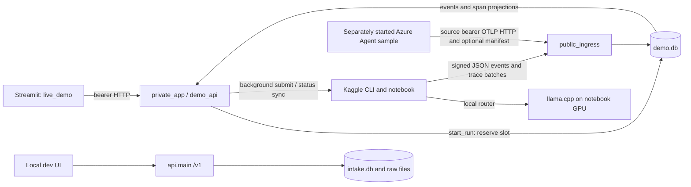
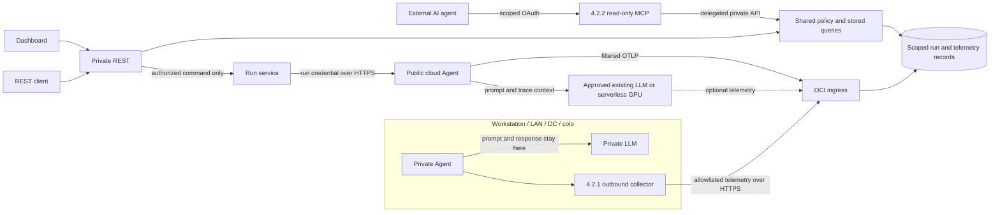

# Phase 4.2.0 — Architecture discovery and assessment

**Review decision requested:** adopt existing endpoints first. Keep the two working telemetry paths and the Kaggle API. Put run submission behind a client for the selected Agent and inference behind a client in the Agent's network, not behind a cloud provisioning API. Extract read-only, authorized queries **before** exposing another reader. This is a design recommendation, not approval to deploy or incur charges.

## Evidence and limits

Investigated 2026-11-24 UTC against the supplied [technical design v2, especially §§2–4](../phase4/AOB_Phase_4.2_Technical_Design_v2.md) and [roadmap v2, §§3–3.2](../phase4/AOB_Product_Roadmap_Phase_4.2-4.7_v2.md). Both inputs are under `docs/phase4/`, not `docs/`. Only this report is a G0 change.

* AOB references below are relative to `5tannerpl/agent-ops-board`, `runtime_phase1` at `c0cbfef1f5f4cc6cb5d738f5d6a36ff925b30770`. No tracked source changes at discovery start. The two untracked v2 inputs were left intact.
* `AZ/` below means `samples/azure-python-agent/` in the sibling `aob-cloud-connectors` checkout, `main` at `f1ca679` **plus existing working-tree edits** (including benchmark, models and telemetry). Tests exercised that checkout, not a pulled GHCR image. The publication workflow and Agent entrypoint were unmodified.
* Evidence classes: **source** describes what these checkouts implement; **local test** means executed against disposable data; **historical** records a previous run; **proposed** is not implemented. No cloud account, running OCI host, production DB, provider invoice or staging target was inspected. No paid calls, credentials collected, production mutations or cloud resources created. Existing account spend is unknown.

## Current architecture: what actually runs

There is **no** AOB-to-Azure start arrow in the current flow. Seeing an Azure trace in the UI is evidence of ingestion, not of deployment or execution authority.

| Area | Source evidence and consequence |
|---|---|
| UI and BFF | `dashboard/app.py:12–26`, `dashboard/auth_gate.py:42–77`, `dashboard/api_client.py:15–30,74–142`, `dashboard/live_demo.py:288–305,330–406`: Streamlit login obtains an access token, calls `/api/me`, posts Start and reruns the selection; active run fragment polls every 3 s. UI reads via HTTP, not SQL. External view does not select `source_id`. Production stops before legacy controls. `deploy/oci/README.md:3–25,45–55` describes a **different** React/Cloudflare Pages + MarcheAgents BFF topology and the isolated Streamlit topology; no React/BFF source here. Do not mount new routes on the separate BFF by assumption. |
| Run admission and lifecycle | `demo_api.py:62–117`, `demo_service.py:22–109`, `demo_store.py:17–35,104–152`: `start_run` syncs active runs, then `create_run` enforces one global active slot, user cooldown and rolling daily cap in a transaction. Random `run-<hex>`; no client idempotency key. FastAPI background submission invokes `kaggle_launcher.submit`; accepted push means queued, not GPU-ready. Events and throttled CLI status advance submitting → queued → running → complete/failed/cancelled. Timeout is recorded as failed; scheduler completion alone does not pass validation. No demo cancel command, durable dispatch queue or generic run client. Active rows survive restart; an interrupted submission can time out on later sync. |
| Kaggle execution | `kaggle_launcher.py:402–442,573–620,721–end` stages the notebook with run-specific callback configuration, invokes Kaggle CLI, polls **kernel** status (not a general per-run resource API). `kaggle-notebook/kernel-metadata.json:7–15` requests T4 and two attached datasets. Notebook `notebookb061a06458.ipynb` there, lines 34–36,46–59,69–92,118–140: restores CUDA binary, picks first sorted matching GGUF, binds loopback and runs validation. `notebook-check/notebookb061a06458.ipynb:295–325` names `qwen3-4b-instruct-2507-q8_0.gguf`; this is not a verified HF repo, revision, digest or pinned llama.cpp build. `scaling/bootstrap.py:27–52,62–85`, `scaling/gpu_manager.py:14–49,76–132`, `scaling/inference_router.py:128–150,182–202`: local process/device selection, `nvidia-smi` and per-unit routing. Reuse measured events, synthetic intake, unit IDs and evidence validation; do **not** export this process manager as a serverless autoscaler. Separate model prechecks from workload calls. |
| Azure deployment vs image publication | Sibling `.github/workflows/publish-agent.yml:3–14,23–42` builds/pushes `ghcr.io/5tannerpl/aob-python-agent:{phase4,sha-<commit>}` on amd64; no Azure login or Container Apps update. `AZ/Dockerfile:1–12`: Python 3.12.12, hash-locked runtime, UID 10001, one uvicorn worker on 8080. Companion `AOB_Phase4_0_Azure_Python_100_Tasks_OTel_Implementation_v2.md:263–304` gives **operator CLI instructions**, not an execution receipt. Neither repo shows a GHCR registration service or AOB resource-management API. Exact Portal vs CLI vs outside automation, deployed revision/digest, app ID, ingress/auth configuration and staging availability remain operator questions. Treat existing app as external. |
| Azure execution | `AZ/app/main.py:21–54,74–115`, `AZ/app/models.py:6–44`, `AZ/app/benchmark.py:27–113`, `AZ/app/agent.py:17–36`: one active run/process, memory-only history (128), four cooperative asyncio workers each process 25 synthetic units, no persistent queue, model client, business retry loop or cancel/pause API. 60 s execution timeout; remaining queued units marked failed, exporter flush/finalization reported separately. Shutdown closes provider; restart loses replay history. Accepts inbound `traceparent`, not arbitrary baggage. Never treat deterministic classification as LLM usage. |
| Inference | `config.py:19–25`, `workers/model_client.py:41–85,88–124,170ff`, `workers/worker.py:244–263`: `ModelClient.generate` already isolates Ollama, llama.cpp chat completions and mock. Local base URL plus path, timeout, optional unit header; no general inference bearer or cross-network trace injection. Repair can send previous output again. Keep this caller contract; a managed GPU is not part of it. |
| OCI packaging | `deploy/oci/compose.isolated.yaml:4–38,40–98,100–180`: ARM64 target; dashboard (1536 MiB, PID cap 128), control (768 MiB/1 CPU), ingress (512 MiB/1 CPU); loopback host ports 18501/18010/18011. Shared named data volume for the two APIs, internal control network, edge and control egress. File-backed secrets for Streamlit, allowlist, event signing and Kaggle; OTLP token map in ingress environment, non-secret read catalog on control. `deploy/oci/compose.yaml:4–48,50–96` instead has two services, no published host ports, external edge to existing Caddy for TLS; not the isolated OTLP configuration. Neither template proves effective TLS routes, mounts, image digest or live limits. |

### Persistence, data and recovery

* `storage/db.py:10–81,90–118`: local intake, lease/jobs, workers, step attempts, evidence, outbox, attachment metadata and load tests in SQLite; WAL, busy timeout, short `BEGIN IMMEDIATE` transactions. Raw email/chat/call content and attachments are files (`intake/service.py:50–74`, `storage/files.py:28–55`); segments become prompt and repair input, validated quotes become evidence (`intake/schema.py:31–57`, `workers/worker.py:244–287`). These business records are **not** a telemetry export schema.
* `demo_store.py:23–36,61–98,154–180`: separate `demo.db`, owner/time and status indexes, signed events unique per run/event. `trace_store.py:15–40,124–157,195–259` stores signed batches and spans per run/trace/span with run/time and unit indexes, derives call ancestry and measured tokens. GPU snapshots are typed **events** projected by `demo_scaling.py:13–33,94–120`, not a provider metric time-series database.
* `otlp_api.py:31–119,123–181`, `otlp_store.py:13–54,56–97,129–157,212ff`, `otlp_semantics.py:24–104`: OTLP/HTTP protobuf only (no gRPC listener); locked `opentelemetry-proto` 1.45.2. Credential binds source, not a claimed producer label. Store allowlisted attributes, resource/scope, nanos, run/unit/worker and parent IDs. Unique `(source_id,trace_id,span_id)`, indexed by source/run/time and source/run/unit. Exact replay is a duplicate; differing content rolls batch back and records conflict. `TRACE_COMPLETE` needs a matching manifest/counts and valid parent graph (including declared external edges; no unresolved/cyclic links or conflicts). Late spans can change completeness. Neither HTTP ACK nor trace completeness establishes business success.
* Schema is initialized on connect, with additive column checks; no versioned migration framework or general retention/purge job identified. Callback expiry/revocation is not deletion. Signed post-run trace grace differs from active-only events. External read rollups can materialize a whole run. Bound storage and query cost before opening access.
* Recovery procedure for a **later authorized release**: record image digests, configuration versions and actual mounted paths; quiesce writers and use SQLite backup for each database plus consistent raw/attachment/result files, never copy a live WAL database alone. Verify integrity and old read projections on a copy. To restore, stop writers, retain post-upgrade backup, restore snapshot on a clean volume with correct ownership and no stale WAL/SHM, restore matching configuration/images; check health, authorized reads and denied reads before resuming. No production backup was made. Local rehearsal below.

### Existing HTTP contracts to preserve

Paths are grouped by host. `R` is the run ID on that host; do not assume the Azure ID format matches `demo_store.RUN_ID_RE`.

| Host / method and path | Contract, identity and limits |
|---|---|
| Private GET `/api/me`; POST `/api/demo/start` | RS256 Auth0 API bearer, required issuer/audience/expiry/subject, enabled allowlist (`demo_auth.py:24–68`). Me returns `user_id,can_start_demo`. Start body optional: `light` (10) or `high_concurrency` (50/100/150, default 100); 202 run view, 409 busy, 429 + Retry-After, 422 invalid. Distinguish auth failures 401/403. |
| Private GET `/api/demo/runs`, `/api/demo/{R}/{status,state,metrics,summary,validation,trace-summary,llm-calls}`, `/api/demo/{R}/units/{unit_id}/trace` | Last 20 owned runs in `items`; per-run owner mismatch → 404. Status includes scheduler and derived result; state/metrics/summary from events; `llm-calls` has limit (max 250), offset, sort and filters. **Not pure reads today:** `owned_run` and run list can reconcile active Kaggle runs and write state (`demo_api.py:62–128,262–283`). |
| Private GET `/api/external/sources`, `/api/external/runs`, `/api/external/runs/{R}/{summary,units,workers,timeline,traces}`, `/traces/{trace_id}`, `/traces/{trace_id}/timeline`, `/units/{unit_id}/spans` (last three relative to run) | Configured source catalog intersected with user grants; denied explicit source → 404. Missing source selects first granted; absent grants have legacy single-source fallback. DTOs vary (`items`, `spans`, schema-v1 summary). Trace list/timeline page to 1000; older list/timeline/unit-spans can omit limit and fetch all; units/workers aggregate unpaged (`demo_api.py:286–373`). No general tenant registry or OAuth read scopes. |
| Ingress POST `/api/events`, `/api/traces` | JSON; timestamp + HMAC signature over raw bytes with per-run key. Event envelope/schema, type and bounds checked; 200 accepted/duplicate. Trace batch ID + spans, 202 counts; bounded post-run acceptance (`demo_api.py:132–257`, `demo_auth.py:70ff`). Not interchangeable with OTLP. |
| Ingress POST `/v1/traces`, `/v1/traces/complete` | Per-source bearer. Protobuf (default 2 MiB/1000 spans), 200 protobuf + accepted/duplicate headers; optional JSON manifest with run, expected units/spans and allowed external parents. Invalid MIME 415, size 413, conflicting identity/manifest 409. No read rights for an ingest token. No public source-registration route. |
| Azure Agent POST `/demo/runs`; GET `/demo/runs/{R}` and `/demo/runs/{R}/units`; GET `/healthz` | Run bearer except health. Strict `{external_run_id: "azure-py-<UUID>", task_count:100, concurrency:4}` with fixed workflow/dataset defaults. New POST **waits** for execution, normally 200 with outcome; same ID/body returns cached outcome or 202 if running; mismatched replay/busy 409, capacity 503, timeout 504. GET is process-local, unknown 404. No `/api/demo/start` on this host. |
| Local development `/v1/dashboard`, `/v1/workers`, `/v1/intake-units`, `/v1/messages`, `/v1/load-tests` and detail/action routes | `api/main.py:25–36,53–85,109–241`. Legacy combined dev app refuses production; dashboard read can probe model version. Load-test stop is **not** demo cancel. Private and ingress apps expose `/healthz` but do not mount these dev routes; public ingress does not expose private list/start. A `/v1/dashboard` 404 there is deliberate, not a missing production route (`api/{private_app,public_ingress}.py:11–25`, `tests/test_security_routes.py:7–16`). |

## Proposed minimum change

Keep the current processes, REST shapes and two stores of trace evidence. Add a registry and small protocols only at the points where a second backend actually differs. No common provider superclass with mandatory cloud credentials.

| Boundary (proposed) | Responsibility and first affected modules | Explicit exclusion |
|---|---|---|
| `DeploymentProvider` | Optional control-plane `capabilities`, `inspect`, later `provision/delete(resource_ref, operation_id)`. Add registry to the private service backed by additive `demo_store` tables. Registering external metadata is a local registry operation **even when no provider adapter exists**. | No Agent start, model request, health-triggered provisioning or implicit adoption of lifecycle ownership. |
| `AgentRunClient` | `start(context)`, `get_status(remote_run_ref)`, optional `cancel`. Wrap `kaggle_launcher.submit/kernel_status` at `demo_service`; implement separate authenticated HTTP client for the existing Azure Run API. Persist remote ID before dispatch, reuse on retry; reconcile ambiguity rather than blindly resubmit after restart. | Not a GPU scheduler, deployment engine or inference client. Cancellation unsupported by either current demo contract must be reported as such. |
| `InferenceProvider` | Per-execution-domain `complete(request, trace_context)` with an approved endpoint, model, optional inference credential, deadline and usage result. Adapt `workers/model_client.ModelClient` without changing existing `generate` callers. Azure opt-in client belongs in **AZ**, beside `benchmark.py`, with deterministic default retained. Normalize base URL once (avoid duplicate `/v1`), propagate allowlisted context, cap calls/tokens. | No private prompt transit via OCI, provider management key, model download or endpoint deletion. |
| `TelemetryProvider` | Optional read-only collector `get_health/get_metrics(ref, window)` writes timestamped observations into stored projections. Keep authenticated push in `demo_api`/`otlp_api`; reuse `demo_scaling`, `trace_store`, `otlp_store`, `otlp_semantics`. Reserve `connector_ref` and telemetry-policy reference, no listener. | No requirement for pull access to receive OTLP; no synchronous provider poll on history reads. Unknown is not zero. |

**Data model.** Add a `Deployment` record (tenant/owner, ID, provider, agent/inference role, ownership, connection mode, execution policy, capability set, config version, status). Endpoint, source, credential, provider resource, image/digest and connector references are optional by role. An existing LLM needs neither an Agent run contract nor a cloud account. A push-only source needs neither an endpoint URL nor an LLM key. Do not put secret values in snapshots. Source binding is explicit: an ingest source is not itself a tenant, provider or grant.

Add a run binding to stable local run ID, authorized tenant/owner, agent/inference deployments and versions, `(source_id, remote_run_id)`, workload version, deadline and cancellation intent. Allow external observed runs without a local Start. Namespace old owned runs and source-scoped runs; never merge on bare run/trace/worker ID across sources. Leave old rows readable without guessing ownership. Use a unique `(tenant, operation, idempotency_key)` reservation with request hash/recorded result; differing payload → conflict. Track business outcome, telemetry completeness and deployment/replica observations independently. A deployment may be ready while a replica is cold; a completed run need not release a replica.

### Provider capability matrix

“Optional” means advertised and verified for this resource, **not** a method that silently succeeds. Effective actions = resource capabilities ∩ ownership rules ∩ execution policy ∩ principal grants ∩ network reachability.

| Integration / maturity | Deployment lifecycle | Agent run | Inference | Telemetry and scaling |
|---|---|---|---|---|
| Kaggle notebook (current) | CLI stages/pushes configured kernel for a run; no generic provision/delete | Submit + kernel status; no demo cancel | In-notebook llama.cpp/local router | Signed events/traces; measured local GPU data. Notebook controls its own processes. |
| Existing public cloud Agent (Azure sample verified locally) | External registration proposed; management not needed | Authenticated start/status/units if compatible; sample lacks cancel | Sample has none; future Agent may select separate LLM | Source OTLP push today; no Azure metric pull required. Other agents without run contract remain observable. |
| Existing RunPod LB / other public HTTPS LLM (proposed) | Register without management key, image or rental | None | Authorized OpenAI-compatible chat from reachable Agent; provider-specific auth to verify | Optional gateway spans/vendor metrics. Provider owns replica scaling; metrics may be unavailable. |
| Future dedicated managed public Agent / serverless endpoint | Optional management adapter after explicit creation approval | Agent only, as advertised | Inference endpoint only, as advertised | Use provider control-plane samples if available; not Kaggle GPU commands. |
| Local workstation, LAN, enterprise DC or colo (reserved 4.2.1) | External by default; no OCI inspect of private address | In-domain Agent if authorized; connector commands deferred | Local CPU/Metal/GPU or private LLM; no public ingress needed | Push-only first. Optional local NVML/exporter where permitted; CPU-only/no collector → GPU N/A. No egress → future site-local AOB, not a tunnel. |

### Resource ownership and lifecycle matrix

| Object / authority | Register or create | Run end, cancel, expiry, failure | Unregister / delete |
|---|---|---|---|
| External Agent, LLM or shared endpoint; operator owns infra | Metadata-only, default observe-only. Separate explicit execute grant and **endpoint-specific** credential if needed. No GHCR, rental or cloud admin prerequisite. | Stop new authorized work; best-effort run cancel only if supported. Leave resource untouched, even after AOB restart. | Revoke AOB grants/credentials and detach binding. Never issue provider delete/stop/scale; retain authorized historical references. |
| AOB-managed dedicated deployment | Explicit, separately authorized provision with budget, operation ID and persisted proof of ownership/provider ID. Default is **not** managed. | Same run semantics. No deployment cleanup on run completion or uncertain network response. | Explicit audited manage/delete operation, recheck tenant, ownership, exact provider ID and shared references. Fail closed on ambiguity. |
| AOB run and local registration | AOB owns metadata; authorized start reserves budget/slot and immutable version snapshot. Ingest-only observation is not a start. | Finish/cancel/timeout the **run**; allow late evidence under policy. Tombstone retired registration, not its history. | Retention/access policy governs local records; no cascading provider delete. |
| Inference replica / notebook GPU process | Vendor creates LB replicas; notebook controls only its own local processes. Neither is the long-lived endpoint. | Vendor idle policy governs release; do not infer zero workers or stopped billing. | No generic replica delete. Record last observation, source, time and confidence. |

### Target network and data flows (not deployed)

The public Agent sends actual content only to the explicitly selected inference destination. OCI stores permitted IDs, timing, outcome and usage; cost/health queries read stored samples. Private execution stays at the site; authorize and redact **before** egress. Later connector enrollment: single-use token → short-lived site/tenant/source-bound credential; rotation, revocation, heartbeat, bounded offline queue with deduplication. Only predefined commands for bound resource IDs via outbound polling, no arbitrary URL, shell, port forwarding or inbound LLM exposure. Until implemented, a `private_connector` execution request returns `NOT_SUPPORTED`/disconnected without probing the address.

## Shared services, permissions and MCP reservation

`demo_api.py` currently combines FastAPI dependencies, principal checks, run reconciliation and projections. Move owner/source grant resolution from `demo_api.py:62–67,286–304` into one transport-independent policy; reuse `demo_auth.py:37–68` for identity verification. Supply a server-derived principal (issuer/subject, tenant membership, scopes, delegated vs service identity). Never trust requested `owner_id`, source labels or a tool annotation. Keep legacy whitelist/single-source behavior confined to the compatibility adapter; require explicit source grants for new access.

Split `RunCommandService` from stored `RunQueryService`/telemetry queries. Reconciliation belongs to an authorized background/control path, not a read tool. Do not reuse `owned_run` as-is, `api.main.model_info`, or schema-initializing `demo_store.connect` as a read-only service. Keep existing REST serialization and polling semantics during transition. Internally use the same scoped run reference, outcome/trace status, bounded page and observation DTOs across adapters. SQL predicates must include authorized source/owner **before** counting, joining, filtering or paginating. A separate MCP process should invoke a scoped private service API; no DB mount, deployment keys, model URL, browser cookie or implicit service-account escalation.

| Future read-only MCP tool | Shared query and available evidence | Required scope in addition to tenant + resource grant |
|---|---|---|
| `list_runs` | `RunQuery.list`: owner-indexed `demo_store.list_runs` + source-scoped `otlp_store.list_runs`; bounded stable pagination, no `sync_run`. | `aob:runs:read` |
| `get_run_summary` | `RunQuery.summary`: stored `demo_service.summarize_run`/`demo_scaling.summary` or `otlp_store.summary`; distinguish outcome, validation and partial trace. | `aob:runs:read` (summary projection only) |
| `get_run_trace` | `TraceQuery.page`: `trace_store.unit_trace`, `otlp_store.traces/timeline`; require scoped run and optional trace/unit, page a redacted projection. No raw event dump. | `aob:traces:read` |
| `get_failed_tasks` | `TaskQuery.failures`: `otlp_store.units`/`otlp_semantics.outcomes`; expose unit, attempt, final status and safe code. Unknown/missing outcome is not failure; aggregate-only Kaggle data cannot identify individual failures. | `aob:runs:read` |
| `get_llm_metrics` | `MetricQuery.llm`: `trace_store.summary/calls`, `otlp_semantics.metrics`; aggregate measured calls/usage, indicate coverage and unavailable dimensions. No prompt or completion. | `aob:metrics:read` |
| `get_gpu_metrics` | `MetricQuery.gpu`: historical `demo_scaling.metrics` snapshots, later stored provider samples. Include unit, time window, provenance, freshness; no live probe. | `aob:metrics:read` |

Proposed new contract: capped time window, stable cursor with tie-breaker, server max rows and serialized bytes, validated filters; return `items`, `next_cursor`, `as_of`, provenance (`measured`, `provider_reported`, `estimated`, `unavailable`). Push limits into storage, not just output slicing. Return unknown/null with reason rather than invented zero. Invalid credentials → 401, missing scope → 403, missing/inaccessible resource → same 404, malformed filter → 422, quota → 429; translate stable codes to MCP results without raw exceptions. Audit principal, action, scoped IDs, decision and correlation ID, not user content. For 4.2.2 validate OAuth issuer, dedicated audience/resource, expiry and scopes plus client compatibility; preserve browser session/CSRF protections for UI. Instrument MCP calls separately to avoid recursive self-observation.

## Risks and required controls

| Risk demonstrated by the current design or new integration | Gate before enabling |
|---|---|
| Existing `require_demo_access` is not granular RBAC; colliding external IDs and implicit single-source grants could leak records. History paths can poll Kaggle; dev model version probes can wake a remote worker. | Separate observe, execute and manage grants. Use resource-scoped SQL, a read-only connection and no network-capable adapters on the query path. Keep dev and control routes off public ingress. |
| Configurable endpoints cross trust boundaries. Model requests include message text; `_raise_for` includes upstream response text, and worker errors can be persisted (`workers/model_client.py:50–56`, `workers/worker.py:167–178`). Span names, validation strings and IDs can carry content despite attribute filtering. | Approved HTTPS destinations, validated DNS/IP on connect, blocked metadata/private/loopback targets from OCI, no unsafe redirects. Keep private routing at site. Separate run, inference, ingest, read and management secrets. Allowlist exported fields/values, replace body/error text with codes, bound payloads, rate-limit and audit. Treat tool results as untrusted data. |
| Durable AOB records vs volatile Agent replay cache; duplicate paid runs after timeouts; long-lived shared endpoint mistaken for disposable replica. | Persist admission/dispatch key and remote reference; reconcile uncertain outcome before retry, bounded backoff only on safe operations. No delete on run cleanup. Durable deadline independent of UI, in-flight work may still complete. |
| Inference can cost money **even with an existing endpoint**. Cold start, retries, repair prompts, idle tail, storage and transfer matter. Polling a data-plane health endpoint may itself scale up. | Default-off execution flag, whitelisted users, explicit paid authorization, one run at a time, max tasks/concurrency/tokens/replicas, daily/monthly budget reservation and watchdog. Adopt/register/history/validate must not infer or warm. Stop new requests on budget or uncertain state, notify operator, reconcile against provider bill; estimates are not hard caps. Shared endpoint costs unattributed unless measured; private internal rate optional, unknown ≠ free. |
| SQLite growth, unbounded legacy reads, offline telemetry backlog; mutable image/model tags and unknown ARM64 runtime. | Bound queues, queries, cardinality and retention; restore rehearsal, pinned trusted image/model digests, no arbitrary image execution on OCI. Require native image smoke and provider-specific staging evidence before release. |

## Regression evidence from this investigation

Linux x86_64, CPython 3.12.3, separate temporary virtualenvs from `requirements.lock` and `AZ/requirements-test.lock` (`--require-hashes` for AZ). Followed `README.md:89` and the [4.1-C reproduction procedure](../phase4/phase4_1C_release_readiness.md). Full AOB run used an empty inherited environment with a temporary HOME/runtime, localhost test servers and the sibling interpreter enabled. No real Auth0, Kaggle submission, Azure deployment, inference or GPU rental.

| Executed | Passed | Failed | Skipped | Interpretation |
|---|---:|---:|---:|---|
| `AOB_RUNTIME_DIR="$T/runtime" AOB_AZURE_TEST_PYTHON="$T/azure/bin/python" "$T/aob/bin/python" -m pytest -q -ra -p no:cacheprovider --basetemp="$T/aob-tests"` | 142 | 5 | 0 | 43.88 s, one Starlette test-client deprecation warning. **Not a green release baseline.** |
| From `AZ/`: `"$T/azure/bin/python" -m pytest -q -p no:cacheprovider --basetemp="$T/sample-tests"` | 10 | 0 | 0 | 2.76 s. Local Agent contract/transport, not ACA ingress. |
| `verify_capture.py evidence/spans.jsonl.gz evidence/sample-run.json` (AZ interpreter) | pass | — | — | Checked-in capture: one root, 4 workers, 100 distinct units and 300 leaf spans; 404 internal parent links. |
| `git archive c88fe266` in temp dir; old `tests/test_trace_observability.py::test_trace_ingestion_is_signed_bounded_and_idempotent`, then current `tests/rehearse_phase4_migration.py <old-checkout> <test-demo.db>` | 1 + rehearsal pass | 0 | 0 | Old rows, additive schema, independent restarts, integrity, old reader and restored backup verified on disposable data only. |

* All five AOB failures are in `tests/test_staging_config.py`: `test_staging_requires_all_authentication_inputs` and four parameterizations of `test_staging_rejects_non_isolated_event_urls`. The validator applies production HTTPS rules where staging expects exactly the isolated internal HTTP ingress. The expected internal URL is rejected; other cases get the wrong rejection or are accepted. Same failure set as the prior 4.1-C report. Resolve staging policy separately without weakening production TLS.
* Both cases of `tests/test_azure_otlp_live.py:58–148` ran **on loopback** inside the 142 passes. Real sample executed 100 tasks, 4 × 25, 100 validations passed, zero failed/unknown, zero LLM calls. 405 acknowledged/persisted spans, 404 internal edges, plus one declared inbound edge in the parent case. No manifest → partial; matching manifest → complete; exact replay adds zero, conflicting replay → 409 and partial. This verifies wire-to-private-read compatibility, **not** the live cloud deployment.
* Kaggle regression: mocked submit/status (`tests/test_demo_api.py:33–49`), signed batches, historical Console Exporter shape (308 spans, batches 200 + 108, reconstructed fixture in `tests/test_trace_upload_staging.py:8–55`), fake llama dual-GPU routing and drain (`tests/test_scaling.py:280–327`). The [historical upload incident](../AOB_Phase_3_1D_Trace_Upload_Fix_Report.md) reported 308 source spans but zero persisted before the fix. Do not report the fixture as a successful live notebook run.
* No tracked AOB GitHub Actions architecture matrix. Companion workflow publishes amd64. Prior amd64 image smokes are historical; [ARM64 verification runbook](../phase4/phase4_1C_arm64_verification.md) records a pending gate. No images built/published here. Live Azure 100-task, Kaggle GPU, OCI ARM64 and RunPod/cache/billing evidence remain unverified. No chargeable provider operations performed; no claim about unrelated running infrastructure costs.

## Architectural decision records (proposed for review)

| ID | Decision and reason | Alternative rejected / consequence |
|---|---|---|
| G0-01 | Adopt before provision. External registration is a local binding, never evidence of AOB ownership. | Mandatory GHCR/cloud keys would exclude existing and private infrastructure. Management can be added later without changing execution. |
| G0-02 | Four independent capabilities; Agent invokes inference in the authorized execution domain. | A universal `start()` would conflate an Azure business run with one model call or a cloud resource creation. Unsupported capabilities stay explicit. |
| G0-03 | Separate deployment, run, replica and trace lifecycle; retain provider-specific states and raw identities. | A single “complete” flag would imply successful tasks, complete telemetry and stopped billing without evidence. Use additive bindings, not rewritten history. |
| G0-04 | One scoped policy and stored-query layer behind Dashboard, REST and future MCP; retain separate push auth contracts. | Direct DB reads, browser cookies or reusing a sync-on-read handler for MCP bypass policy or cause side effects. Keep legacy API façades. |
| G0-05 | Outbound-only, telemetry-first private integration. Data residency follows the Agent/LLM trust domain. | No OCI private-IP probing or generic network bridge. No-egress sites require a future local deployment. |
| G0-06 | Preserve trusted Azure deterministic baseline, Kaggle llama.cpp/Q8_0 path; evaluate RunPod LB/Cached Models separately under budget. | Do not replace engines, bake weights into images, infer GPU release or claim 100 LLM calls from validation/classification spans. |

## Recommended implementation sequence and gates

1. **Review G0; hold release.** Operator to identify actual isolated OCI Compose project and proxy routes (including OTLP), mounts/limits/image digests, actual ACA deployment mechanism, resource ID, active revision/image digest, staging app and auth contract. Use only scoped read-only inventory of a confirmed target, never full secret-bearing environment dumps. Resolve staging URL policy and ARM64 gate. Do not infer cloud management requirements until verified.
2. **4.2A, on a separate development branch, default-off flag.** Add registry/bindings, scoped query/command split, capability checks and durable idempotency; preserve existing routes/rows. Fake adapter tests: register external Agent and LLM without image, GPU or management key, even with no deployment adapter; observe-only start denied; run cancel/removal, failure and external unregister make **zero** delete calls. Private address registration makes zero network calls; unsupported returns explicit error.
3. **4.2B.** Wrap Kaggle behavior unchanged; bind Azure run client to verified contract, keep fixed deterministic workflow. Test conflicting/replayed start, process loss, auth, local history and denied cancel. Separate tests with two principals/sources and colliding run IDs: wrong tenant/source/scope denied, invalid/expired audience rejected, pagination/redaction enforced, no polling/inference/deployment on read. CPU-only, missing GPU, absent usage and stale samples must not become zero.
4. **4.2C–H only after explicit budget approval.** Verify HF repo/revision/file checksum and llama.cpp commit, LB auth/headers, cache behavior, cold/warm timing, true idle replica count, provider metric availability and billing on a dedicated bounded endpoint. Then opt in Azure inference, propagate trace context, verify 100 **workload** calls with unit outcomes and late/duplicate handling. Stage with backup, previous revision and feature-flag rollback; preserve Azure-only and Kaggle paths.
5. **4.2.1 reservation, not implementation:** connector identity, connection mode, telemetry policy, heartbeat/staleness and bounded command allowlist. Accept real local/LAN and DC/colo telemetry only after revocation, disconnect/replay, redaction and no-inbound-port tests.
6. **4.2.2 reservation, not implementation:** six read queries above, stable schemas and scopes. Verify SDK/Streamable HTTP, OAuth discovery/delegation, bounded queries, malicious text treated as data, audit isolation and one real client on staging. No control tools, paid actions or extra LLM. BYOA deployment, runtime control, benchmarks, optimization and production hardening remain roadmap work (4.3–4.7), not G0 deliverables.

**Stopping point:** review this report and outstanding evidence. No provider, schema migration, feature flag, Hybrid Connector or MCP Server has been implemented.
